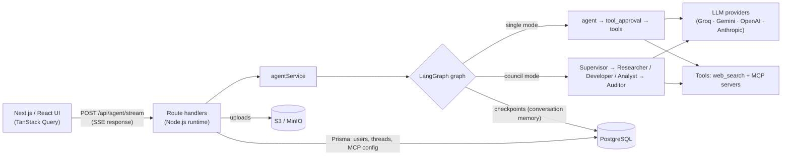

# AgentSphere

[](https://github.com/Mohityadav55199/AgentSphere/actions/workflows/ci.yml)

A full-stack AI agent chat app built with **Next.js 16, React 19, TypeScript and LangGraph.js**. It streams
answers from multiple LLM providers, can run a **5-agent "council"** (Supervisor, Researcher, Developer,
Analyst, Auditor) instead of a single agent, and uses tools — built-in web search and any
**Model Context Protocol (MCP)** server — behind a **human-in-the-loop approval** step.

| Live demo                                                             | Notes                                                     |
| --------------------------------------------------------------------- | --------------------------------------------------------- |
| [agent-sphere-self.vercel.app](https://agent-sphere-self.vercel.app/) | Vercel                                                    |
| [agentsphere.onrender.com](https://agentsphere.onrender.com/)         | Render free tier: the first request after idle takes ~50s |

<!-- Add a screenshot or short GIF of the app here, e.g.  -->

---

## Features

**Chat & agents**

- Streaming responses (Server-Sent Events) from **Groq, Google Gemini, OpenAI or Anthropic**, with automatic
  fallback to another configured provider when one fails or is rate-limited.
- **Single-agent mode** with selectable personas and custom system instructions, or **5-agent council mode**:
  a Supervisor plans and routes to a Researcher, Developer or Analyst, and an Auditor reviews the result.
- **Agent Studio**: switch council roles on/off, and set each role's temperature and extra instructions.
- **Tool approval**: the agent pauses before running a tool; you can allow it, deny it, or **edit its
  arguments** first. Built-in `web_search` (DuckDuckGo, or Tavily with an API key) plus tools from MCP servers.
- Renders Markdown, code blocks (copy / download) and **Mermaid diagrams**.

**App**

- Accounts (email + password) with per-user chat history; guests get private chats tied to their browser.
- Thread sidebar with search, pinning, rename and automatic titles.
- File attachments (images, PDF, Markdown/text) stored in S3-compatible storage (MinIO locally).
- Voice input and read-aloud (Web Speech API), dark mode, export to Markdown / JSON / print.
- MCP server manager (HTTP and local stdio servers, presets, JSON import, OAuth for protected servers).
- OpenAPI 3.1 spec at `/api/openapi` and interactive docs at `/api-docs`.

---

## Architecture



- **Conversation state** lives in LangGraph's Postgres checkpointer; Prisma stores users, thread metadata and
  MCP server configuration.
- **Tool approval** uses LangGraph `interrupt()`; the UI resumes the graph with a `Command` carrying
  _allow_, _deny_ or _edited arguments_.
- **Streaming** is a POST request whose response is an SSE stream, read by a small client parser
  (`src/services/sseClient.ts`), so long and non-ASCII messages are not limited by URL length.

More detail: [docs/ARCHITECTURE.md](docs/ARCHITECTURE.md) · [docs/API.md](docs/API.md) ·
[docs/OAUTH.md](docs/OAUTH.md) · [docs/OBSERVABILITY.md](docs/OBSERVABILITY.md)

---

## Engineering notes

Things I worked through that are worth calling out:

- **Council routing with tools.** Any specialist that requests a tool goes through approval → tools → back to
  _that same_ specialist. Routing a Researcher's tool call straight to the next agent leaves an unanswered tool
  call in the history, which every provider rejects. Disabled roles are not added to the graph at all, and each specialist has a tool budget (3 rounds per message) so a model that keeps searching cannot loop until the run aborts.
- **Tools + provider fallback.** A fallback-wrapped model has no `bindTools`, so tools have to be bound to the
  primary model and to each fallback before the chain is rebuilt; otherwise tools silently stop working.
- **Security on a public demo.**
  - Thread ownership checks for every read/write; guest chats are isolated with an httpOnly cookie.
  - Session tokens are HMAC-signed and require `JWT_SECRET` in production; passwords use scrypt.
  - stdio MCP servers (arbitrary shell commands) are disabled in production, and HTTP MCP URLs pointing at
    private/loopback/metadata addresses are rejected (SSRF).
  - Rate limits on login, sign-up and chat; LLM Markdown is sanitized (`rehype-sanitize`); Mermaid runs in
    strict mode; the MCP OAuth callback verifies a `state` cookie.
- **Free-tier hosting.** No cron jobs or keep-alive pings; the "server is waking up" banner polls only while the
  server is down, so an idle tab never keeps the Render instance awake.

---

## Tech stack

| Area     | Tools                                                                                         |
| -------- | --------------------------------------------------------------------------------------------- |
| Frontend | Next.js 16 (App Router), React 19, TypeScript, Tailwind CSS v4, TanStack Query                |
| AI       | LangGraph.js, LangChain providers, MCP (`@langchain/mcp-adapters`), optional Langfuse tracing |
| Backend  | Next.js route handlers, Prisma, PostgreSQL (Neon in production), Zod + OpenAPI 3.1            |
| Storage  | S3-compatible object storage (MinIO locally)                                                  |
| Quality  | Vitest (81 tests), ESLint, Prettier, GitHub Actions CI, Dependabot                            |
| Hosting  | Render and Vercel                                                                             |

---

## Running locally

**Requirements:** Node.js 20.9+, pnpm (via `corepack enable`), Docker (for Postgres + MinIO), and at least one
LLM API key (Groq and Google Gemini both have free tiers).

```bash
git clone https://github.com/Mohityadav55199/AgentSphere.git
cd AgentSphere
corepack enable
pnpm install

cp .env.example .env          # then fill in at least one API key and JWT_SECRET
docker compose up -d          # Postgres on :5434, MinIO on :9000 (console :9001)
pnpm exec prisma db push      # create the tables
pnpm dev                      # http://localhost:3000
```

Key environment variables (see [.env.example](.env.example) for all of them):

| Variable                                                                   | Purpose                                                    |
| -------------------------------------------------------------------------- | ---------------------------------------------------------- |
| `DATABASE_URL`                                                             | PostgreSQL connection string                               |
| `GROQ_API_KEY` / `GOOGLE_API_KEY` / `OPENAI_API_KEY` / `ANTHROPIC_API_KEY` | LLM providers (any one is enough)                          |
| `JWT_SECRET`                                                               | Signs session cookies; **required in production**          |
| `S3_*`                                                                     | Upload storage (MinIO defaults work with `docker compose`) |
| `MCP_ALLOW_STDIO`                                                          | Allow local stdio MCP servers in production (default off)  |

| Command                                              | What it does                   |
| ---------------------------------------------------- | ------------------------------ |
| `pnpm dev`                                           | Development server (Turbopack) |
| `pnpm build` / `pnpm start`                          | Production build / server      |
| `pnpm test`                                          | Unit and integration tests     |
| `pnpm lint` · `pnpm typecheck` · `pnpm format:check` | Static checks                  |

---

## Known limitations

- Rate limits are kept in memory, which is fine for one instance but not shared across several.
- MCP server configuration is global: any signed-in user can change it.
- Token and cost figures under each answer are estimates from text length, not provider usage data.
- On free LLM tiers, council mode (several model calls per message) can hit per-minute token limits.

---

Built by [Mohit Yadav](https://github.com/Mohityadav55199).
