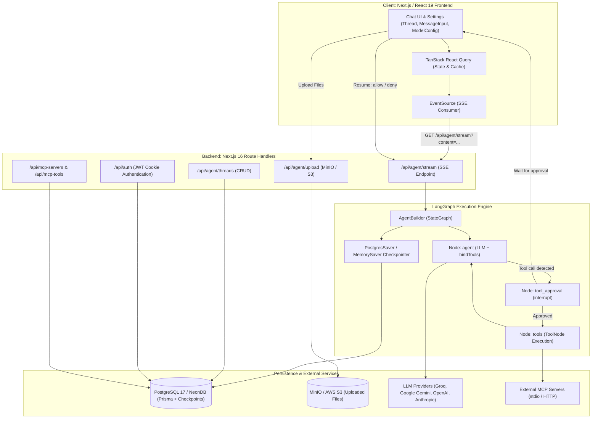

# 🧭 00-START-HERE.md — Master Index & Study Roadmap

Welcome to the **AgentSphere Study Guide & Technical Blueprint**. This document is your master index, learning roadmap, and preparation manual for technical interviews (including SDE Intern and Full-Stack AI Engineer interviews).

---

## 📌 Document Metadata & Verification Notice

- **Target Repository**: `AgentSphere` (Fullstack Next.js + LangGraph.js AI Platform)
- **Primary Source Codebase**: [c:/Projects/AgentSphere](file:///c:/Projects/AgentSphere)
- **Status Categories Applied Throughout This Guide**:
  - `[VERIFIED IN CODE]`: Confirmed directly by source code inspection.
  - `[INFERRED]`: Highly probable architectural deduction based on codebase patterns.
  - `[GENERAL CONCEPT]`: Foundational theory required to understand the mechanism.
  - `[NOT FOUND / NOT VERIFIED]`: Feature, test, or behavior absent in the implementation.

---

## 1. What is AgentSphere?

**AgentSphere** is a production-oriented, full-stack autonomous AI agent web application built with **Next.js 16 (App Router)**, **React 19**, **LangGraph.js**, **Prisma ORM**, **PostgreSQL**, and the **Model Context Protocol (MCP)**.

### In Plain English

Most AI web apps are simple "chatbots": you send a prompt, and a single model generates text. AgentSphere goes beyond plain chat by creating an **agentic system**:

1. It connects to **external tool servers** via the Model Context Protocol (MCP).
2. It pauses execution when an AI model requests a tool and asks for **human approval** (Human-in-the-Loop).
3. It retains persistent conversational state in PostgreSQL using LangGraph checkpointers.
4. It accepts multimodal inputs (file uploads like images, PDFs, text files) stored in an S3-compatible object storage (MinIO/AWS S3).
5. It offers interactive **agent personas**, voice input, read-aloud speech, and real-time response analytics.

### Real-World Analogy

Think of a traditional chatbot like an encyclopedia clerk who can only recite memorized facts. **AgentSphere** is like an **executive operations manager**:

- When you ask a question requiring internal data or external actions, the manager drafts a tool command.
- Before executing the command, the manager steps into your office and asks: _"I want to run this database query / search command. Do you approve?"_
- Once approved, the specialist runs the tool, inspects the result, and formulates the final answer.

---

## 2. The Core Problem AgentSphere Solves

Standard Language Model applications suffer from three critical bottlenecks:

1. **Hallucination & Static Knowledge**: LLMs know only what was in their training data.
2. **Lack of Autonomous Action (Tool Integration)**: LLMs cannot natively query databases, trigger API endpoints, or execute terminal commands without integration code.
3. **The Danger of Uncontrolled Actions**: Giving an LLM direct access to tools (like sending an email or dropping a database table) is dangerous without a human confirmation gate.

**AgentSphere solves this by combining:**

- **Dynamic Tool Discovery (MCP)**: Tools are configured in PostgreSQL and attached at runtime.
- **Human-in-the-Loop (Interrupts)**: Dangerous tool executions are intercepted via LangGraph's `interrupt()` primitive before execution.
- **Full Traceability**: Conversation state is checkpointed in PostgreSQL turn-by-turn.

---

## 3. High-Level System Architecture

---

## 4. Key Technologies at a Glance

| Technology                   | Real Version (`package.json`) | Role in AgentSphere                                                   |
| ---------------------------- | ----------------------------- | --------------------------------------------------------------------- |
| **Next.js**                  | `16.2.9`                      | Full-stack framework (App Router, Server Components & Route Handlers) |
| **React**                    | `19.2.7`                      | UI library with concurrent rendering & optimistic UI                  |
| **TypeScript**               | `6.0.3`                       | End-to-end static typing                                              |
| **Tailwind CSS**             | `4.3.1`                       | Utility-first styling with modern CSS engine                          |
| **LangGraph.js**             | `1.4.5`                       | Cyclic state graph orchestrator for agents & tool interrupts          |
| **LangChain Core**           | `1.2.1`                       | Message abstractions (`AIMessage`, `HumanMessage`, `ToolMessage`)     |
| **MCP Adapters**             | `1.1.3`                       | Dynamic tool integration via Model Context Protocol                   |
| **Prisma ORM**               | `6.16.2`                      | Type-safe database queries and migrations                             |
| **PostgreSQL**               | `pg 8.22.0`                   | Relational database (metadata + LangGraph checkpoints)                |
| **AWS SDK S3**               | `3.1075.0`                    | Object storage client (connects to local MinIO or AWS S3)             |
| **TanStack Query**           | `5.101.0`                     | Client-side async state synchronization & caching                     |
| **OpenTelemetry & Langfuse** | `0.219.0` / `5.5.3`           | Distributed tracing and LLM observability                             |
| **Scalar / OpenAPI**         | `0.11.5` / `8.5.0`            | Interactive API documentation viewer (`/api-docs`)                    |

---

## 5. Most Important Files to Understand First

If you have only 15 minutes to review the codebase, open these 8 files in this exact order:

1. [src/lib/agent/builder.ts](file:///c:/Projects/AgentSphere/src/lib/agent/builder.ts): **The Brain**. Defines the LangGraph `StateGraph`, the `agent`, `tool_approval`, and `tools` nodes, conditional edges, and human review interrupts.
2. [src/lib/agent/index.ts](file:///c:/Projects/AgentSphere/src/lib/agent/index.ts): Factory that caches and initializes the agent with chosen LLM, tools, checkpointer, and system prompt.
3. [src/lib/agent/util.ts](file:///c:/Projects/AgentSphere/src/lib/agent/util.ts): Model provider selector (`createChatModel`) supporting Groq, Google, OpenAI, Anthropic, and the JSON Schema sanitizer for Gemini.
4. [src/services/agentService.ts](file:///c:/Projects/AgentSphere/src/services/agentService.ts): Connects user prompts or tool approval commands to LangGraph execution and yields incremental chunks.
5. [src/app/api/agent/stream/route.ts](file:///c:/Projects/AgentSphere/src/app/api/agent/stream/route.ts): Server-Sent Events (SSE) route handler streaming chunks to the browser.
6. [src/hooks/useChatThread.ts](file:///c:/Projects/AgentSphere/src/hooks/useChatThread.ts): Core client hook managing optimistic UI, EventSource subscriptions, and chunk concatenation.
7. [prisma/schema.prisma](file:///c:/Projects/AgentSphere/prisma/schema.prisma): Database definitions for `User`, `Thread`, and `MCPServer`.
8. [src/lib/auth.ts](file:///c:/Projects/AgentSphere/src/lib/auth.ts): Lightweight custom JWT session authentication implemented using Node.js built-in `crypto`.

---

## 6. Complete Documentation Directory Structure

This study guide is organized into 18 purpose-built guides in `docs/agentsphere-study-guide/`:

| File                                                                                                                                                                | Title                                | Description                                                                    |
| ------------------------------------------------------------------------------------------------------------------------------------------------------------------- | ------------------------------------ | ------------------------------------------------------------------------------ |
| [00-START-HERE.md](file:///c:/Projects/AgentSphere/docs/agentsphere-study-guide/00-START-HERE.md)                                                                   | Master Index & Roadmap               | Executive summary, tech stack, reading order, and interview checklist          |
| [01-PROJECT-FROM-ZERO.md](file:///c:/Projects/AgentSphere/docs/agentsphere-study-guide/01-PROJECT-FROM-ZERO.md)                                                     | Project From Zero                    | First principles: from simple scripts to LLM APIs and autonomous agents        |
| [02-TECHNOLOGY-STACK-EXPLAINED.md](file:///c:/Projects/AgentSphere/docs/agentsphere-study-guide/02-TECHNOLOGY-STACK-EXPLAINED.md)                                   | Technology Stack Deep Dive           | Comprehensive analysis of all dependencies, versions, and alternatives         |
| [03-SYSTEM-ARCHITECTURE.md](file:///c:/Projects/AgentSphere/docs/agentsphere-study-guide/03-SYSTEM-ARCHITECTURE.md)                                                 | System Architecture & Diagrams       | Mermaid architectural diagrams, data flows, and failure modes                  |
| [04-FRONTEND-COMPLETE-WALKTHROUGH.md](file:///c:/Projects/AgentSphere/docs/agentsphere-study-guide/04-FRONTEND-COMPLETE-WALKTHROUGH.md)                             | Frontend Walkthrough                 | React 19, Next.js routing, optimistic UI, Speech API, and components           |
| [05-BACKEND-AND-API-COMPLETE-WALKTHROUGH.md](file:///c:/Projects/AgentSphere/docs/agentsphere-study-guide/05-BACKEND-AND-API-COMPLETE-WALKTHROUGH.md)               | Backend & API Inventory              | Complete API catalog, request/response contracts, and route handlers           |
| [06-LANGCHAIN-LANGGRAPH-AND-AGENTS.md](file:///c:/Projects/AgentSphere/docs/agentsphere-study-guide/06-LANGCHAIN-LANGGRAPH-AND-AGENTS.md)                           | LangChain, LangGraph & Agents        | StateGraph, nodes, edges, checkpoints, and interrupt patterns                  |
| [07-LLM-PROVIDERS-AND-TOOL-CALLING.md](file:///c:/Projects/AgentSphere/docs/agentsphere-study-guide/07-LLM-PROVIDERS-AND-TOOL-CALLING.md)                           | LLM Providers & Tool Calling         | Multi-provider inference, Gemini schema sanitization, and MCP execution        |
| [08-DATABASE-POSTGRESQL-PRISMA-AND-PERSISTENCE.md](file:///c:/Projects/AgentSphere/docs/agentsphere-study-guide/08-DATABASE-POSTGRESQL-PRISMA-AND-PERSISTENCE.md)   | Database & Persistence               | Prisma schema, PostgreSQL storage, and LangGraph checkpointer tables           |
| [09-AUTHENTICATION-SESSIONS-AND-SECURITY.md](file:///c:/Projects/AgentSphere/docs/agentsphere-study-guide/09-AUTHENTICATION-SESSIONS-AND-SECURITY.md)               | Auth, Sessions & Security            | Password hashing (scrypt), JWT cookies, threat models, and missing safeguards  |
| [10-ENVIRONMENT-SETUP-AND-DEPLOYMENT.md](file:///c:/Projects/AgentSphere/docs/agentsphere-study-guide/10-ENVIRONMENT-SETUP-AND-DEPLOYMENT.md)                       | Environment & Deployment             | Local Docker (MinIO/Postgres), Vercel, Render, and startup troubleshooting     |
| [11-FILE-BY-FILE-CODE-TOUR.md](file:///c:/Projects/AgentSphere/docs/agentsphere-study-guide/11-FILE-BY-FILE-CODE-TOUR.md)                                           | File-by-File Code Tour               | Detailed file inventory with exports, line references, and call graphs         |
| [12-END-TO-END-FEATURE-TRACES.md](file:///c:/Projects/AgentSphere/docs/agentsphere-study-guide/12-END-TO-END-FEATURE-TRACES.md)                                     | End-to-End Feature Traces            | Step-by-step traces of chat, tool approvals, file uploads, and auth            |
| [13-ERROR-HANDLING-DEBUGGING-AND-TESTING.md](file:///c:/Projects/AgentSphere/docs/agentsphere-study-guide/13-ERROR-HANDLING-DEBUGGING-AND-TESTING.md)               | Error Handling & Debugging           | Diagnosing SSE failures, DB disconnects, rate limits, and testing audit        |
| [14-DESIGN-DECISIONS-TRADEOFFS-AND-IMPROVEMENTS.md](file:///c:/Projects/AgentSphere/docs/agentsphere-study-guide/14-DESIGN-DECISIONS-TRADEOFFS-AND-IMPROVEMENTS.md) | Decisions, Trade-Offs & Improvements | Architectural rationale, trade-offs, and prioritized engineering improvements  |
| [15-INTERVIEW-QUESTIONS-AND-ANSWERS.md](file:///c:/Projects/AgentSphere/docs/agentsphere-study-guide/15-INTERVIEW-QUESTIONS-AND-ANSWERS.md)                         | 100+ Interview Questions & Answers   | Comprehensive interview Q&A with follow-ups, code anchors, and whiteboard tips |
| [16-QUICK-REVISION-AND-GLOSSARY.md](file:///c:/Projects/AgentSphere/docs/agentsphere-study-guide/16-QUICK-REVISION-AND-GLOSSARY.md)                                 | Quick Revision & 50-Term Glossary    | 1-minute pitch, 2-minute pitch, glossary, and last-minute interview checklist  |
| [17-LEARNING-EXERCISES.md](file:///c:/Projects/AgentSphere/docs/agentsphere-study-guide/17-LEARNING-EXERCISES.md)                                                   | Hands-On Learning Exercises          | Progressive code exploration and feature extension challenges with answers     |

---

## 7. Recommended Learning Order

### Stage 1: Mental Model & First Principles (Day 1)

1. Read [01-PROJECT-FROM-ZERO.md](file:///c:/Projects/AgentSphere/docs/agentsphere-study-guide/01-PROJECT-FROM-ZERO.md) to understand what distinguishes an LLM wrapper from an agent.
2. Read [02-TECHNOLOGY-STACK-EXPLAINED.md](file:///c:/Projects/AgentSphere/docs/agentsphere-study-guide/02-TECHNOLOGY-STACK-EXPLAINED.md) to learn each tool's role and trade-off.
3. Review [03-SYSTEM-ARCHITECTURE.md](file:///c:/Projects/AgentSphere/docs/agentsphere-study-guide/03-SYSTEM-ARCHITECTURE.md) to see how components communicate.

### Stage 2: Deep Dive into the Code (Day 2)

4. Read [06-LANGCHAIN-LANGGRAPH-AND-AGENTS.md](file:///c:/Projects/AgentSphere/docs/agentsphere-study-guide/06-LANGCHAIN-LANGGRAPH-AND-AGENTS.md) and [07-LLM-PROVIDERS-AND-TOOL-CALLING.md](file:///c:/Projects/AgentSphere/docs/agentsphere-study-guide/07-LLM-PROVIDERS-AND-TOOL-CALLING.md) to master the AI core.
5. Read [05-BACKEND-AND-API-COMPLETE-WALKTHROUGH.md](file:///c:/Projects/AgentSphere/docs/agentsphere-study-guide/05-BACKEND-AND-API-COMPLETE-WALKTHROUGH.md) and [04-FRONTEND-COMPLETE-WALKTHROUGH.md](file:///c:/Projects/AgentSphere/docs/agentsphere-study-guide/04-FRONTEND-COMPLETE-WALKTHROUGH.md).
6. Read [08-DATABASE-POSTGRESQL-PRISMA-AND-PERSISTENCE.md](file:///c:/Projects/AgentSphere/docs/agentsphere-study-guide/08-DATABASE-POSTGRESQL-PRISMA-AND-PERSISTENCE.md) and [09-AUTHENTICATION-SESSIONS-AND-SECURITY.md](file:///c:/Projects/AgentSphere/docs/agentsphere-study-guide/09-AUTHENTICATION-SESSIONS-AND-SECURITY.md).

### Stage 3: End-to-End Tracing & Code Tours (Day 3)

7. Trace features in [12-END-TO-END-FEATURE-TRACES.md](file:///c:/Projects/AgentSphere/docs/agentsphere-study-guide/12-END-TO-END-FEATURE-TRACES.md).
8. Use [11-FILE-BY-FILE-CODE-TOUR.md](file:///c:/Projects/AgentSphere/docs/agentsphere-study-guide/11-FILE-BY-FILE-CODE-TOUR.md) to inspect functions file-by-file.
9. Study failure diagnosis in [13-ERROR-HANDLING-DEBUGGING-AND-TESTING.md](file:///c:/Projects/AgentSphere/docs/agentsphere-study-guide/13-ERROR-HANDLING-DEBUGGING-AND-TESTING.md).

### Stage 4: Interview Mastery (Day 4)

10. Read [14-DESIGN-DECISIONS-TRADEOFFS-AND-IMPROVEMENTS.md](file:///c:/Projects/AgentSphere/docs/agentsphere-study-guide/14-DESIGN-DECISIONS-TRADEOFFS-AND-IMPROVEMENTS.md) to defend your architecture.
11. Practice answering questions in [15-INTERVIEW-QUESTIONS-AND-ANSWERS.md](file:///c:/Projects/AgentSphere/docs/agentsphere-study-guide/15-INTERVIEW-QUESTIONS-AND-ANSWERS.md).
12. Use [16-QUICK-REVISION-AND-GLOSSARY.md](file:///c:/Projects/AgentSphere/docs/agentsphere-study-guide/16-QUICK-REVISION-AND-GLOSSARY.md) for pre-interview revision.
13. Complete exercises in [17-LEARNING-EXERCISES.md](file:///c:/Projects/AgentSphere/docs/agentsphere-study-guide/17-LEARNING-EXERCISES.md).

---

## 8. The 20 Most Critical Things You Must Understand

1. **StateGraph Cyclic Workflow**: Unlike a linear chain, AgentSphere's LangGraph graph is cyclic: `agent -> tool_approval -> tools -> agent`. It loops until the model finishes without requesting tools.
2. **Human-in-the-Loop Interrupts**: The `tool_approval` node calls LangGraph's `interrupt()` function, pausing the graph and preserving state until the user approves or denies.
3. **Resuming with Command**: When the user clicks "Allow" or "Deny", the client does _not_ send a new message. It sends `new Command({ resume: { action: ... } })` to unblock the suspended node.
4. **SSE (Server-Sent Events) over WebSockets**: The app uses HTTP GET with `text/event-stream` headers, because the AI flow is unidirectional streaming from server to client.
5. **Two Layers of Persistence**: Thread _metadata_ (title, pin, user) is stored in Prisma's `Thread` table; actual message turns and tool states are stored in LangGraph's PostgreSQL checkpointer tables (`checkpoints`, `checkpoint_writes`).
6. **Dynamic Tool Loading via MCP**: MCP tools are not hardcoded. They are loaded dynamically from `MCPServer` records stored in PostgreSQL via `@langchain/mcp-adapters`.
7. **Gemini Schema Sanitization**: Google Gemini crashes on standard JSON Schema keywords (e.g., `$schema`, `examples`, `anyOf`). AgentSphere recursively scrubs these schemas in [src/lib/agent/util.ts](file:///c:/Projects/AgentSphere/src/lib/agent/util.ts#L76-L249).
8. **Multi-Provider Architecture**: The backend dynamically routes prompts to Groq (via OpenAI-compatible baseURL), Google Gemini, OpenAI, or Anthropic based on user preference and configured API keys.
9. **Optimistic UI in React**: In [src/hooks/useChatThread.ts](file:///c:/Projects/AgentSphere/src/hooks/useChatThread.ts#L170-L183), the user's message is immediately added to the TanStack Query cache under a temporary ID before the network call starts.
10. **Custom Zero-Dependency JWT**: [src/lib/auth.ts](file:///c:/Projects/AgentSphere/src/lib/auth.ts) implements HS256 JWT signing and verification using Node.js's built-in `crypto` module (`crypto.createHmac`, `crypto.timingSafeEqual`).
11. **Password Hashing with Scrypt**: Passwords are saved as `salt:hash` using `crypto.scryptSync` (64 bytes) with a 16-byte random salt, preventing plain-text exposure.
12. **Multimodal File Pipeline**: Files are validated on upload for MIME type and size, stored in MinIO/S3, and passed as image/document content blocks to the LLM.
13. **Dynamic Route Registration**: OpenAPI documentation is assembled dynamically using `@asteasolutions/zod-to-openapi` from co-located `schema.ts` files.
14. **Smart Thread Titling**: In [src/lib/thread.ts](file:///c:/Projects/AgentSphere/src/lib/thread.ts), the first user prompt is stripped of Markdown and shortened to generate a concise thread title.
15. **Thread Claiming upon Auth**: Unauthenticated guest threads (`userId: null`) can be claimed by a user once they register or log in.
16. **Voice Synthesis & Recognition**: Browser-native Web Speech API handles both microphone transcription (`SpeechRecognition`) and audio read-aloud (`SpeechSynthesisUtterance`).
17. **Observability via Langfuse & OpenTelemetry**: Two layers of tracing: process-wide OTel spans in `instrumentation.ts` and step-level LangGraph callbacks in `agentService.ts`.
18. **Docker Compose Setup**: [compose.yaml](file:///c:/Projects/AgentSphere/compose.yaml) provisions PostgreSQL on port `5434` (to avoid conflicting with default 5432) and MinIO on `9000`/`9001` with an automated bucket provisioner (`createbuckets`).
19. **Missing Test Suite [AUDIT FINDING]**: The repository currently contains _no_ unit, integration, or end-to-end tests (`.test.ts` or `.spec.ts`).
20. **Orphaned Checkpoint Trade-Off [AUDIT FINDING]**: Deleting a thread in Prisma deletes the metadata row, but the checkpointer's binary records in PostgreSQL remain orphaned until cleaned up.

---

## 9. Interview Preparation Readiness Checklist

Before your technical interview, make sure you can answer YES to each of these questions:

- [ ] Can you whiteboard the LangGraph StateGraph (nodes, edges, conditional branches)?
- [ ] Can you explain the difference between a simple LangChain chain and a LangGraph cyclic agent?
- [ ] Can you explain what an SSE stream looks like over the wire (`data: {...}\n\n`, `event: done\n`)?
- [ ] Can you explain why tool schemas must be sanitized for Google Gemini?
- [ ] Can you describe how the client unpauses a suspended tool interrupt using a `Command` object?
- [ ] Can you explain why passwords use `scrypt` and how `timingSafeEqual` prevents timing attacks?
- [ ] Can you explain how TanStack React Query maintains client-side cache consistency while streaming?
- [ ] Can you explain how MCP standardizes tool communication over `stdio` and `http` transports?
- [ ] Can you explain what happens when MinIO or PostgreSQL goes down while an agent is running?
- [ ] Can you name 3 concrete production improvements you would make to this codebase?

Proceed directly to [01-PROJECT-FROM-ZERO.md](file:///c:/Projects/AgentSphere/docs/agentsphere-study-guide/01-PROJECT-FROM-ZERO.md) to build your foundation from first principles.
