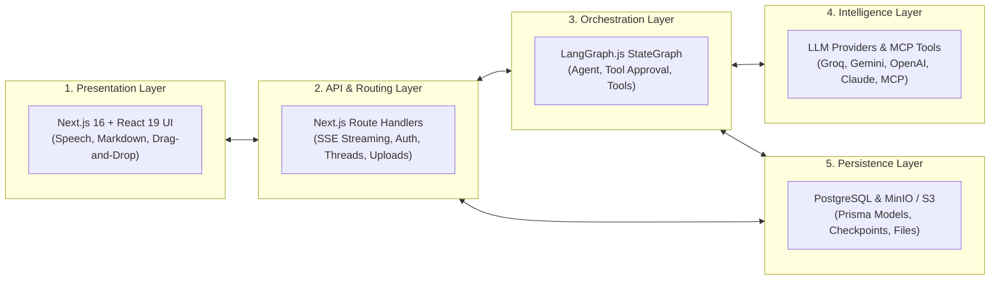

# 🐣 01-PROJECT-FROM-ZERO.md — AgentSphere from First Principles

---

## 📌 Document Metadata & Grounding Notice
- **Target Repository**: `AgentSphere`
- **Knowledge Level Assumed**: Basic JavaScript / React / Web knowledge. No prior AI or LangGraph experience required.
- **Verification Rule**: Every claim is distinguished by `[VERIFIED IN CODE]`, `[INFERRED]`, or `[GENERAL CONCEPT]`.

---

## 1. What Makes an Application an "AI Application"?

### The Conventional Web App vs. The LLM App vs. The Autonomous Agent

To understand AgentSphere, we must look at how software architecture has evolved across three distinct generations:

| Dimension | Generation 1: Classical Web App | Generation 2: LLM Wrapper (Chatbot) | Generation 3: Agentic Platform (AgentSphere) |
|---|---|---|---|
| **Logic Source** | Hardcoded `if/else` statements and SQL queries written by humans. | Probabilistic text generation from a foundation model. | An orchestrator that loops between reasoning, tool calling, and human review. |
| **Data Access** | Reads and writes only to its internal relational/NoSQL database. | Limited to the prompt context window and training cutoff date. | Dynamically queries external systems, APIs, files, and MCP servers. |
| **Execution Flow** | Deterministic: Step A always triggers Step B. | Linear: Input prompt $\rightarrow$ Model generates text $\rightarrow$ Response returned. | Cyclic: Model plans $\rightarrow$ Model requests tool $\rightarrow$ System pauses for human approval $\rightarrow$ Tool runs $\rightarrow$ Model evaluates result $\rightarrow$ Loops until solved. |
| **Action Capacity** | Only performs explicit database CRUD operations coded in endpoints. | Passive text generation (cannot take real-world actions). | Active tool execution (can execute scripts, fetch live APIs, query services). |

### Real-World Analogy
1. **The Classical Web App** is like a **vending machine**: You press button B4, a mechanical arm drops the soda. It does exactly what its physical gears allow, nothing more.
2. **The LLM Wrapper** is like an **expert author locked in an isolated room without internet**: You slip a note under the door with a question. The author writes an eloquent, detailed answer from memory and slips it back. But if you ask *"What is the weather outside right now?"* or *"Please cancel my flight,"* the author is helpless.
3. **The Agentic Platform (AgentSphere)** is like an **executive operations manager equipped with a phone, terminal, and approval clipboard**: When you say *"Analyze this document and pull current data,"* the manager figures out what external tools are needed, drafts the action, asks for your signature if dangerous, executes the action, reads the output, and hands you the completed result.

> **Where the Analogy Breaks Down:**
> A human manager has real-world common sense and general awareness. An AI agent is a probabilistic statistical engine predicting tokens. If the system prompts or tool parameter schemas are vague, the agent can loop infinitely, attempt invalid arguments, or misinterpret tool results.

---

## 2. What Does "Multi-Agent" Mean vs. What AgentSphere Implements?

### General Concept
In AI engineering literature, a **Multi-Agent System (MAS)** often refers to a network of multiple autonomous LLM instances running separate graphs, communicating with one another (e.g., a "Coder Agent" debating an "Architect Agent", moderated by a "Critic Agent").

### Verified Reality in AgentSphere `[VERIFIED IN CODE]`
Let us be technically precise about what exists in the AgentSphere repository:
- **Architecture**: AgentSphere implements a **dynamic single-agent cyclic state machine** built on LangGraph.js, configured in [src/lib/agent/builder.ts](file:///c:/Projects/AgentSphere/src/lib/agent/builder.ts#L101-L151).
- **Interactive Personas**: In [src/contexts/UISettingsContext.tsx](file:///c:/Projects/AgentSphere/src/contexts/UISettingsContext.tsx#L35-L71), AgentSphere offers 5 distinct personas:
  1. `General Assistant` (everyday tasks)
  2. `Senior Developer` (production code, TypeScript, architecture)
  3. `Data Scientist` (quantitative analysis, statistics, mathematics)
  4. `Content Strategist` (copywriting, storytelling, marketing)
  5. `Security Auditor` (vulnerability scans, OWASP compliance)
- **How Personas Work**: Choosing a persona switches the runtime system prompt injected into the LangGraph `agent` node. It does *not* spawn 5 independent concurrent LangGraph sub-agents talking to each other.
- **Why This Matters for Interviews**: If an interviewer asks *"How do your agents communicate with each other?"*, answering *"They send messages in a multi-agent debate loop"* would be factually incorrect and easily disproven. The accurate answer is:
  > *"AgentSphere implements a flexible, persona-driven agent architecture using a LangGraph StateGraph. The system swaps specialized role prompts and dynamically binds external Model Context Protocol (MCP) tool servers. The graph handles human-in-the-loop tool approvals before cyclic execution."*

---

## 3. The Problem AgentSphere Solves

Before AgentSphere, if a developer wanted to build an AI platform that could interact with external APIs, databases, and local scripts, they faced several friction points:
1. **Tool Lock-In**: Every tool had to be hardcoded in Python or TypeScript with custom schemas and execution handlers.
2. **Security & Unchecked Execution**: Letting an LLM autonomously invoke functions can lead to unintended actions (e.g., executing a destructive terminal command or emailing a client prematurely).
3. **Lost State across Refresh**: Without persistent memory checkpointers, refreshing the browser or interrupting an execution erases the conversation context.
4. **Provider Rigidity**: Applications locked into a single provider (e.g., OpenAI-only) break when rate limits hit or prices change.

AgentSphere solves these problems by providing:
- **Dynamic Tool Integration via MCP**: Add any external tool server (database, web search, GitHub) through the UI without touching backend code.
- **Human-in-the-Loop Interrupts**: The system pauses and asks the user to allow or deny tool calls before execution.
- **Turn-by-Turn Persistence**: PostgreSQL checkpointers store state transitions at every step of the graph.
- **Multi-Provider Flexibility**: Toggle effortlessly between Groq (high-speed inference), Google Gemini, OpenAI, and Anthropic.

---

## 4. The Five Layers of AgentSphere



### Layer 1: Presentation Layer (Frontend)
- **Location**: [src/components/](file:///c:/Projects/AgentSphere/src/components), [src/app/](file:///c:/Projects/AgentSphere/src/app)
- **Role**: Renders the chat interface, formats Markdown with LaTeX math via KaTeX, captures microphone input using the browser Speech Recognition API, reads text aloud via Speech Synthesis, and manages drag-and-drop file attachments.

### Layer 2: API & Routing Layer (Backend)
- **Location**: [src/app/api/](file:///c:/Projects/AgentSphere/src/app/api)
- **Role**: Receives HTTP and Server-Sent Event (SSE) requests, validates request payloads with Zod schemas, extracts authentication cookies, and pipes stream chunks back to the client.

### Layer 3: Orchestration Layer (The State Machine)
- **Location**: [src/lib/agent/builder.ts](file:///c:/Projects/AgentSphere/src/lib/agent/builder.ts), [src/services/agentService.ts](file:///c:/Projects/AgentSphere/src/services/agentService.ts)
- **Role**: Coordinates the lifecycle of a query. Determines whether the model wants to call a tool, pauses for human approval, executes the tool, and feeds results back to the model.

### Layer 4: Intelligence & Tooling Layer
- **Location**: [src/lib/agent/util.ts](file:///c:/Projects/AgentSphere/src/lib/agent/util.ts), [src/lib/agent/mcp.ts](file:///c:/Projects/AgentSphere/src/lib/agent/mcp.ts)
- **Role**: Connects to the LLM APIs (Groq, Google Gemini, OpenAI, Anthropic) and interfaces with external tools via the Model Context Protocol over `stdio` (local subprocesses) or `http` (remote servers).

### Layer 5: Persistence Layer (Storage)
- **Location**: [prisma/schema.prisma](file:///c:/Projects/AgentSphere/prisma/schema.prisma), [src/lib/agent/memory.ts](file:///c:/Projects/AgentSphere/src/lib/agent/memory.ts), [src/lib/storage/](file:///c:/Projects/AgentSphere/src/lib/storage)
- **Role**: PostgreSQL stores user accounts, thread metadata, and MCP server configurations via Prisma, while LangGraph's checkpointer saves deep graph execution states. MinIO/S3 stores uploaded media and documents.

---

## 5. A Realistic User Journey: Step-by-Step

Let's walk through an actual scenario where a user asks AgentSphere to inspect a system using a connected MCP tool.

```mermaid
sequenceDiagram
    autonumber
    actor User as User (Browser)
    participant UI as Chat UI (React 19)
    participant SSE as /api/agent/stream
    participant LG as LangGraph StateGraph
    participant LLM as LLM (e.g. Groq / Gemini)
    participant MCP as MCP Tool Server
    participant DB as PostgreSQL (Checkpointer)

    User->>UI: Types "Check database status" & clicks Send
    UI->>UI: Optimistically appends Human Message to UI
    UI->>SSE: Opens GET /api/agent/stream?content=Check database status&threadId=t1
    SSE->>LG: Invokes agent.stream({ messages: [HumanMessage] })
    LG->>DB: Loads existing checkpoints for threadId=t1
    LG->>LLM: Sends system prompt + history + tools schema
    LLM-->>LG: Generates ToolCall: { name: "db__check_status", args: {} }
    LG->>LG: Conditional edge detects tool_calls -> routes to tool_approval
    LG->>LG: Calls interrupt({ question: "Is this correct?", toolCall })
    LG-->>SSE: Graph execution suspends; yields tool call data
    SSE-->>UI: Streams SSE data: { type: "ai", data: { tool_calls: [...] } }
    UI->>User: Displays Tool Approval Card: "db__check_status" [Allow] [Deny]
    
    User->>UI: Clicks [Allow]
    UI->>SSE: Opens GET /api/agent/stream?allowTool=allow&threadId=t1
    SSE->>LG: Invokes stream with Command({ resume: { action: "continue" } })
    LG->>LG: tool_approval unblocks -> routes to tools node
    LG->>MCP: Executes db__check_status()
    MCP-->>LG: Returns { status: "healthy", connections: 14 }
    LG->>DB: Checkpoints tool result
    LG->>LLM: Sends tool result back to model for synthesis
    LLM-->>LG: Generates final text: "The database is healthy with 14 active connections."
    LG-->>SSE: Streams text chunks
    SSE-->>UI: SSE streams chunks
    UI->>User: Updates AI message bubble with final formatted Markdown
```

---

## 6. What the User Sees vs. What Happens Behind the Scenes

| What the User Sees on Screen | What is Actually Happening in Code |
|---|---|
| User types a message and clicks **Send**; message appears immediately. | React Query applies an **optimistic update** using a temporary ID (`temp-${Date.now()}`) in [src/hooks/useChatThread.ts](file:///c:/Projects/AgentSphere/src/hooks/useChatThread.ts#L170-L183). |
| The "New Chat" title changes to a clean summary after the first reply. | [src/lib/thread.ts](file:///c:/Projects/AgentSphere/src/lib/thread.ts#L3-L17) runs `generateSmartTitle()`, stripping Markdown and truncating the prompt to create a neat 35-character title. |
| An expandable gray card appears asking to "Allow" or "Deny" a tool. | The LangGraph execution hit `interrupt()` in [src/lib/agent/builder.ts](file:///c:/Projects/AgentSphere/src/lib/agent/builder.ts#L74-L86), pausing the server state machine and saving the suspension in PostgreSQL. |
| The user clicks "Allow" and the AI immediately continues writing. | The frontend sends `allowTool=allow`, triggering `new Command({ resume: { action: "continue" } })` in [src/services/agentService.ts](file:///c:/Projects/AgentSphere/src/services/agentService.ts#L29-L34), resuming execution without restarting the conversation. |
| The AI response streams smoothly word-by-word. | The browser `EventSource` receives SSE packets (`data: {"type":"ai","data":{...}}\n\n`), concatenating chunks in React state. |
| Audio icon clicked $\rightarrow$ browser reads answer aloud. | Web Speech Synthesis API (`window.speechSynthesis.speak(new SpeechSynthesisUtterance(...))`) runs entirely client-side in [src/components/AIMessage.tsx](file:///c:/Projects/AgentSphere/src/components/AIMessage.tsx#L41-L61). |

---

## 7. Limitations & Features Not Implemented `[AUDIT FINDING]`

To ensure complete transparency and technical credibility during an interview, you must know what the codebase **does not** do:

1. **No True Multi-Agent Swarms**: There is no supervisor-worker debate loop or multi-agent routing graph. It is a single-agent cyclic state machine with persona prompt switching.
2. **No Test Suite**: There are no unit or end-to-end tests configured (no Jest, Vitest, Playwright, or Cypress files exist in the repository).
3. **Orphaned Checkpoint Records on Thread Deletion**: Deleting a thread in [src/app/api/agent/threads/route.ts](file:///c:/Projects/AgentSphere/src/app/api/agent/threads/route.ts#L114-L120) deletes the Prisma `Thread` row, but does not purge the LangGraph `checkpoints` rows from PostgreSQL.
4. **SSE Query Parameter Sizing**: Prompt text, tool names, and attachment metadata are passed via URL query parameters (`GET /api/agent/stream?content=...`). If a prompt is exceptionally long (e.g., >8KB), some reverse proxies or browsers may reject the request with HTTP 414 URI Too Long. A production improvement would use `POST` with `fetch` and a `ReadableStream`.
5. **No Rate Limiting or Anti-Abuse Controls**: The API endpoints lack IP-based rate limiting (such as Upstash Redis or token bucket algorithms), making them susceptible to abuse if exposed publicly without an API gateway.

---

## 8. Summary Checklist: Explaining AgentSphere From Zero

When asked in an interview: *"Tell me about AgentSphere from zero"*, use this 4-sentence framework:
1. *"AgentSphere is a full-stack Next.js 16 and React 19 platform that moves beyond passive chatbots into autonomous, tool-calling agents using LangGraph.js."*
2. *"It dynamically attaches tools from external Model Context Protocol (MCP) servers configured in PostgreSQL, and enforces safety through a Human-in-the-Loop approval gate that intercepts dangerous tool calls."*
3. *"State is checkpointed turn-by-turn into PostgreSQL so long-running tasks can be suspended and resumed seamlessly."*
4. *"On the frontend, it features optimistic UI, Server-Sent Events streaming, multimodal file uploads, and browser-native voice input and synthesis."*

Proceed to [02-TECHNOLOGY-STACK-EXPLAINED.md](file:///c:/Projects/AgentSphere/docs/agentsphere-study-guide/02-TECHNOLOGY-STACK-EXPLAINED.md) to explore every dependency and library in detail.
