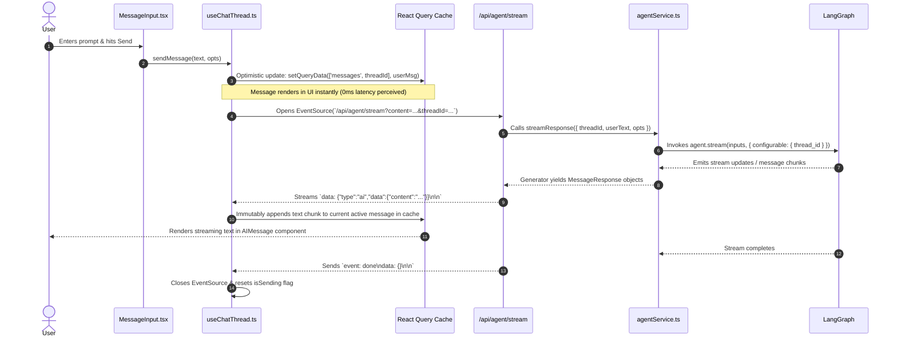
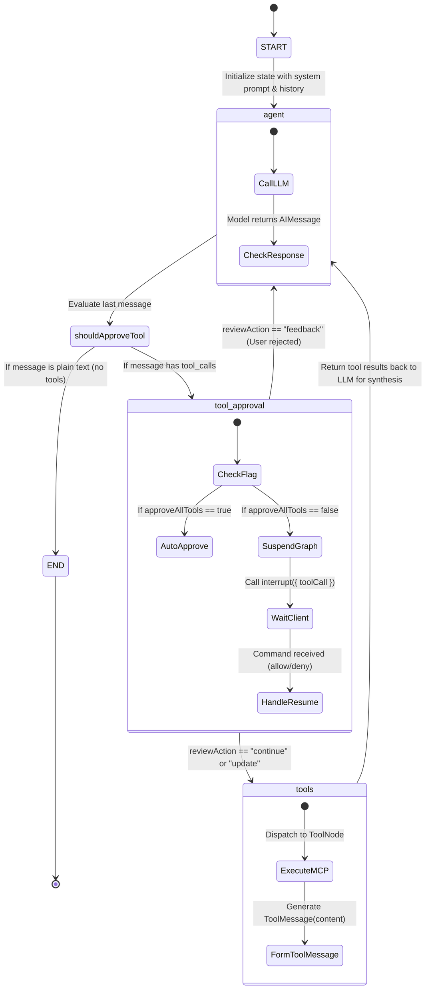
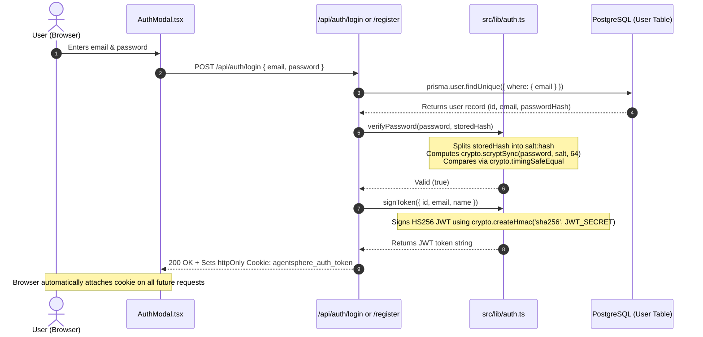

# 🏛️ 03-SYSTEM-ARCHITECTURE.md — System Architecture & Data Flows

---

## 📌 Document Metadata & Architectural Grounding

- **Target Repository**: `AgentSphere`
- **Scope**: Complete architectural anatomy of AgentSphere, mapping frontend components, backend endpoints, orchestration graphs, and database layers.
- **Rule Applied**: Every box, arrow, file reference, and data schema is grounded directly in verified source code.

---

## 1. Overall System Architecture Diagram

```mermaid
graph TB
    subgraph ClientTier ["1. Presentation Tier (Client Browser)"]
        UI_Thread["Thread Component<br/>(src/components/Thread.tsx)"]
        UI_Input["MessageInput Component<br/>(src/components/MessageInput.tsx)"]
        UI_List["MessageList & AIMessage<br/>(src/components/AIMessage.tsx)"]
        Hook_Chat["useChatThread Hook<br/>(src/hooks/useChatThread.ts)"]
        State_RQ["TanStack React Query Cache<br/>(['messages', threadId])"]
        State_Context["UISettingsContext & AuthContext<br/>(src/contexts/)"]
        Client_ES["Browser EventSource (SSE)"]
    end

    subgraph ServerTier ["2. Application Tier (Next.js 16 Backend)"]
        Route_Stream["SSE Route Handler<br/>(src/app/api/agent/stream/route.ts)"]
        Route_Threads["Threads CRUD Route Handler<br/>(src/app/api/agent/threads/route.ts)"]
        Route_Upload["File Upload Route Handler<br/>(src/app/api/agent/upload/route.ts)"]
        Route_Auth["Auth Route Handlers<br/>(src/app/api/auth/)"]
        Route_MCP["MCP Servers & Tools Routes<br/>(src/app/api/mcp-servers/ & mcp-tools/)"]
        Service_Agent["Agent Service<br/>(src/services/agentService.ts)"]
        Service_Auth["Auth Module (JWT & Scrypt)<br/>(src/lib/auth.ts)"]
    end

    subgraph AgentTier ["3. Orchestration & Agent Tier (LangGraph.js)"]
        Builder["AgentBuilder Class<br/>(src/lib/agent/builder.ts)"]
        Node_Agent["Node: agent<br/>(Invokes LLM with bindTools)"]
        Edge_Cond["Conditional Edge:<br/>shouldApproveTool()"]
        Node_Approval["Node: tool_approval<br/>(Calls interrupt())"]
        Node_Tools["Node: tools<br/>(ToolNode executes MCP tools)"]
        Util_Model["createChatModel & Schema Sanitizer<br/>(src/lib/agent/util.ts)"]
    end

    subgraph PersistenceTier ["4. Persistence & External Tier"]
        DB_Prisma["Prisma ORM Client<br/>(src/lib/database/prisma.ts)"]
        DB_Postgres[("PostgreSQL 17 Database<br/>Port 5434")]
        DB_Checkpointer["PostgresSaver Checkpointer<br/>(src/lib/agent/memory.ts)"]
        Storage_S3[("MinIO / AWS S3 Object Storage<br/>Bucket: uploads")]
        Ext_LLMs["LLM APIs<br/>(Groq, Gemini, OpenAI, Claude)"]
        Ext_MCP["External MCP Servers<br/>(stdio processes / HTTP endpoints)"]
    end

    %% Client Interactions
    UI_Input --> Hook_Chat
    Hook_Chat --> State_RQ
    Hook_Chat --> Client_ES
    Client_ES -->|HTTP GET SSE with query params| Route_Stream
    UI_Thread --> Route_Threads
    UI_Input -->|Multipart Form Data| Route_Upload
    State_Context --> Route_Auth

    %% Server to Orchestration
    Route_Stream --> Service_Agent
    Service_Agent --> Builder
    Builder --> Node_Agent
    Node_Agent --> Util_Model
    Util_Model --> Ext_LLMs

    %% LangGraph Cyclic Workflow
    Node_Agent --> Edge_Cond
    Edge_Cond -->|tool_calls exist| Node_Approval
    Edge_Cond -->|no tool_calls (END)| Route_Stream
    Node_Approval -->|Approved / Resumed| Node_Tools
    Node_Tools --> Ext_MCP
    Node_Tools --> Node_Agent

    %% Persistence Connections
    Route_Upload --> Storage_S3
    Route_Threads --> DB_Prisma
    Route_Auth --> DB_Prisma
    Route_MCP --> DB_Prisma
    DB_Prisma --> DB_Postgres
    Builder --> DB_Checkpointer
    DB_Checkpointer --> DB_Postgres
```

---

## 2. In-Depth Component & Flow Analysis

### 2.1 The Client-to-Server Request-Response Lifecycle



#### Detailed Explanation of the Lifecycle:

1. **Trigger**: The user types text into [MessageInput.tsx](file:///c:/Projects/AgentSphere/src/components/MessageInput.tsx).
2. **Optimistic Rendering**: Before sending the HTTP request, [useChatThread.ts](file:///c:/Projects/AgentSphere/src/hooks/useChatThread.ts#L170-L183) writes a synthetic human message (`id: temp-${Date.now()}`) directly into the TanStack Query cache.
3. **Transport Protocol**: The browser initializes an `EventSource` pointing to `/api/agent/stream`. The browser uses `GET` rather than `POST` because native browser `EventSource` only supports GET.
4. **Processing**: [src/services/agentService.ts](file:///c:/Projects/AgentSphere/src/services/agentService.ts) constructs a `HumanMessage` and passes it to `agent.stream()`.
5. **Streaming Output**: As chunks are generated, the server encodes them as SSE data lines (`data: ...\n\n`) and pushes them down the open HTTP connection.
6. **Completion**: When the stream finishes, the server emits a custom `event: done` packet. The client's event listener terminates the connection and clears loading spinners.

---

## 3. The LangGraph Agent Cyclic Workflow

The AI engine inside AgentSphere is not a simple linear chain; it is a **cyclic state graph** managed by LangGraph.js.



### Deep Dive into Each Graph Node & Edge

#### Node 1: `agent` (`src/lib/agent/builder.ts:L123-L135`)

- **Responsibility**: Invokes the configured LLM (`ChatGoogleGenerativeAI`, `ChatOpenAI`, or `ChatAnthropic`).
- **Input**: The accumulated message history from `state.messages`, prepended with the active `SystemMessage`.
- **Output**: An `AIMessage` containing either markdown text, or a list of `tool_calls`.
- **Failure Mode**: If the LLM provider experiences an outage, throws a 429 Rate Limit, or an invalid API key is provided, execution throws here and routes to the stream error handler.

#### Conditional Edge: `shouldApproveTool` (`src/lib/agent/builder.ts:L48-L59`)

- **Responsibility**: Inspects `state.messages[messages.length - 1]`.
- **Logic**:
  - If `lastMessage.tool_calls` is a non-empty array $\rightarrow$ route to `tool_approval`.
  - Else $\rightarrow$ route to `END`.

#### Node 2: `tool_approval` (`src/lib/agent/builder.ts:L61-L121`)

- **Responsibility**: Implements the **Human-in-the-Loop** approval gate.
- **Behavior**:
  - If `this.approveAllTools` is `true`: immediately returns `new Command({ goto: "tools" })`.
  - If `false`: calls `interrupt({ question: "Is this correct?", toolCall })`.
  - Calling `interrupt()` immediately **halts graph execution**, freezes state in PostgreSQL, and returns the tool call details to the client.
- **Resumption**: When the user clicks "Allow" or "Deny", the client resumes the graph with a `Command({ resume: { action: ... } })`:
  - `action === "continue"`: Routes to `tools` node.
  - `action === "update"`: Modifies tool arguments and routes to `tools`.
  - `action === "feedback"`: Injects a `ToolMessage` containing rejection feedback and routes back to `agent` to allow the model to adjust its plan.

#### Node 3: `tools` (`src/lib/agent/builder.ts:L41`)

- **Responsibility**: The prebuilt LangGraph `ToolNode` executes the requested tool.
- **Execution**: Dispatches the tool call to the connected MCP client (`MultiServerMCPClient`) or local dynamic tool.
- **Output**: Returns a `ToolMessage` with the tool's output string.
- **Next Step**: An unconditional edge directs execution from `tools` **back to `agent`**, allowing the LLM to read the tool output and generate the final user-facing response.

---

## 4. Authentication & Session Architecture

AgentSphere implements a secure, zero-dependency authentication architecture using Node.js built-in `crypto` APIs:



### Purpose of Boundaries & Security Guarantees:

- **`httpOnly: true`**: JavaScript in the browser cannot read the cookie document (`document.cookie`), completely preventing token theft via Cross-Site Scripting (XSS).
- **`sameSite: "lax"`**: Protects against Cross-Site Request Forgery (CSRF).
- **`crypto.timingSafeEqual`**: Prevents timing attacks where an attacker measures nanosecond differences in string comparisons to deduce hash characters.
- **Guest-to-User Thread Claiming**: Unauthenticated threads are created with `userId: null`. When a user logs in, [src/lib/thread.ts](file:///c:/Projects/AgentSphere/src/lib/thread.ts#L32-L35) automatically associates the existing thread with the user's ID (`userId: dbUser.id`).

---

## 5. Database Interaction & Persistence Architecture

AgentSphere uses a **dual-layer persistence model**:

```mermaid
graph TD
    subgraph AppData ["Application Data Layer (Prisma ORM)"]
        UserTable["User Table<br/>(id, email, password, createdAt)"]
        ThreadTable["Thread Table<br/>(id, title, isPinned, userId)"]
        MCPTable["MCPServer Table<br/>(id, name, type, command, url, oauthStatus)"]
    end

    subgraph LangGraphData ["Orchestration State Layer (PostgresSaver)"]
        CP_Table["checkpoints Table<br/>(thread_id, checkpoint_id, checkpoint, metadata)"]
        CP_Writes["checkpoint_writes Table<br/>(thread_id, checkpoint_id, task_id, idx, channel, value)"]
    end

    UserTable -->|1 to Many (Cascade Delete)| ThreadTable
    ThreadTable -.->|Logical Link via thread_id| CP_Table
    CP_Table --> CP_Writes
```

### Why Two Separate Storage Mechanisms?

1. **Prisma ORM (`User`, `Thread`, `MCPServer`)**:
   - Manages relational domain metadata.
   - Used for sidebar thread lists, user authentication, and MCP server configuration forms.
2. **PostgresSaver (`checkpoints`, `checkpoint_writes`)**:
   - Manages LangGraph execution graphs.
   - Stores serialized LangChain message objects (`AIMessage`, `ToolMessage`), pending tool calls, interrupt suspension states, and model parameters.
   - Allows LangGraph to resume an interrupted conversation days later using only the `thread_id`.

---

## 6. What Happens When Components Fail? (Failure Mode Analysis)

| Component That Fails                 | Immediate System Behavior                                                | User Experience                                                                                 | Recovery Path                                                               |
| ------------------------------------ | ------------------------------------------------------------------------ | ----------------------------------------------------------------------------------------------- | --------------------------------------------------------------------------- |
| **PostgreSQL Database**              | Prisma and PostgresSaver throw connection errors (`ECONNREFUSED`).       | The UI shows an error banner: _"Loading conversation history failed"_ or stream fails.          | Check Docker container: `docker compose up -d db`. Verify port `5434`.      |
| **LLM Provider API (e.g. Groq 429)** | LangGraph node `agent` throws rate-limit exception during `.invoke()`.   | SSE stream emits `event: error` with `⚠️ Rate limit exceeded`.                                  | Switch provider in UI settings (e.g. from Groq to Google Gemini or OpenAI). |
| **MinIO / S3 Storage**               | File upload endpoint `/api/agent/upload` throws upload failure error.    | Red error alert appears in `MessageInput`: _"Failed to upload file"_.                           | Verify MinIO container: `docker compose up -d minio createbuckets`.         |
| **MCP Tool Server**                  | Tool execution in `ToolNode` times out or exits with non-zero exit code. | Tool error string is returned as `ToolMessage`. Agent reads error and explains failure to user. | Reconfigure server arguments or URL in the MCP configuration modal.         |
| **Client Disconnect Mid-Stream**     | Browser tab closes during SSE stream.                                    | `stream.cancel()` is triggered on Next.js server. Node.js garbage collects the stream.          | The last completed turn remains safely persisted in PostgreSQL.             |

Proceed to [04-FRONTEND-COMPLETE-WALKTHROUGH.md](file:///c:/Projects/AgentSphere/docs/agentsphere-study-guide/04-FRONTEND-COMPLETE-WALKTHROUGH.md) for a complete breakdown of the frontend architecture and user interface components.
