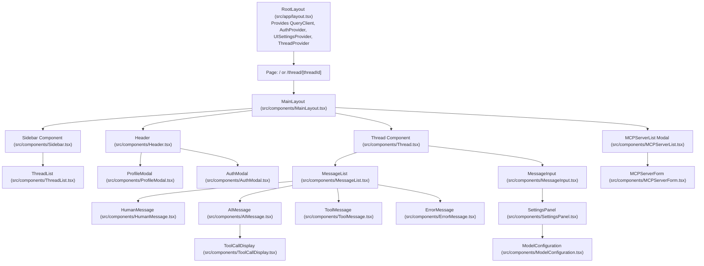
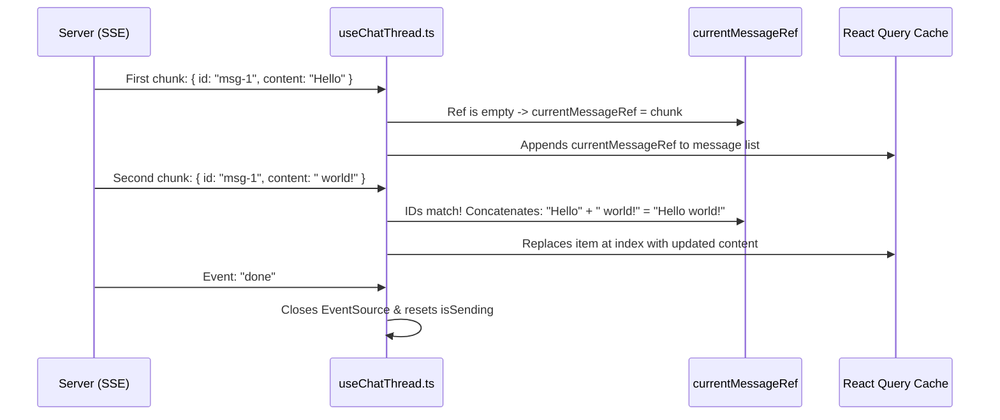

# 🎨 04-FRONTEND-COMPLETE-WALKTHROUGH.md — Frontend Architecture & UI Engine

---

## 📌 Document Metadata & Component Grounding
- **Target Repository**: `AgentSphere`
- **Framework**: Next.js 16.2.9 (App Router) + React 19.2.7 + Tailwind CSS v4.3.1
- **Component Directory**: [src/components/](file:///c:/Projects/AgentSphere/src/components)
- **Context Directory**: [src/contexts/](file:///c:/Projects/AgentSphere/src/contexts)
- **Hooks Directory**: [src/hooks/](file:///c:/Projects/AgentSphere/src/hooks)

---

## 1. Frontend Architecture & Component Hierarchy

AgentSphere's user interface is structured around a central split-pane layout: a collapsable left sidebar for thread management and MCP server configuration, and a main conversational pane for active agent interactions.



---

## 2. Next.js Routing Architecture

AgentSphere leverages the **Next.js App Router** with two primary routes:

### 2.1 The Root Route (`/`)
- **File**: [src/app/page.tsx](file:///c:/Projects/AgentSphere/src/app/page.tsx)
- **Rendering Behavior**: Client-Side Component (`"use client"`).
- **Initialization Logic**:
  1. Calls `useThreads()` to fetch existing threads.
  2. If threads exist, sets `rootThreadId = threads[0].id`.
  3. If no threads exist, calls `createThread()` and initializes a brand new thread ID.
  4. Renders the `<Thread>` component. When the user sends their first message, `onFirstMessageSent` fires:
     ```typescript
     <Thread
       threadId={rootThreadId}
       onFirstMessageSent={(id) => router.replace(`/thread/${id}`)}
     />
     ```
  5. The URL transitions seamlessly from `/` to `/thread/3b9e...` once a conversation begins.

### 2.2 The Thread Route (`/thread/[threadId]`)
- **File**: [src/app/thread/[threadId]/page.tsx](file:///c:/Projects/AgentSphere/src/app/thread/[threadId]/page.tsx)
- **Role**: Dynamic segment extracting `params.threadId` via `useParams()`.
- **Behavior**: Renders `<MainLayout>` containing `<Thread threadId={threadId} />`.

---

## 3. Global Context Providers

AgentSphere wraps the application in 3 React context providers in [src/app/layout.tsx](file:///c:/Projects/AgentSphere/src/app/layout.tsx#L26-L37):

### 3.1 `AuthContext` (`src/contexts/AuthContext.tsx`)
- **State Managed**:
  - `user: UserSession | null` (current user ID, email, name).
  - `isLoading: boolean` (initial session verification status).
  - `isAuthModalOpen: boolean` & `authModalMode: "login" | "register"`.
- **Key Functions**:
  - `checkAuth()`: Hits `GET /api/auth/me` to read the session cookie.
  - `login(email, password)`: Sends credentials to `POST /api/auth/login`.
  - `logout()`: Hits `POST /api/auth/logout`, clears the cookie, and resets user state to `null`.
  - `openAuthModal(mode)` / `closeAuthModal()`.

### 3.2 `UISettingsContext` (`src/contexts/UISettingsContext.tsx`)
- **State Managed**:
  - `provider: string` (default: `"groq"`, fallback: `"google"`, `"openai"`, `"anthropic"`).
  - `model: string` (e.g. `"openai/gpt-oss-120b"`, `"gemini-2.5-flash"`).
  - `persona: string` (current persona ID: `"default"`, `"developer"`, `"analyst"`, `"writer"`, `"auditor"`).
  - `temperature: number` (floating point between `0.0` and `1.0`).
  - `systemPrompt: string` (custom or persona-derived instructions).
  - `approveAllTools: boolean` (if true, bypasses manual tool approval).
  - `theme: "light" | "dark"` (synced with HTML document class).
- **Persistence Mechanism**: Automatically mirrors settings to browser `localStorage` under the key `agent_model_settings`.

### 3.3 `ThreadContext` (`src/contexts/ThreadContext.tsx`)
- **State Managed**: `activeThreadId: string | null` and `setActiveThreadId(id)`.

---

## 4. Custom Hooks: The Frontend Logic Engine

### 4.1 `useChatThread` (`src/hooks/useChatThread.ts`)
The most important hook in the frontend. Manages message history, optimistic updates, and SSE stream consumption.

```typescript
export interface UseChatThreadReturn {
  messages: MessageResponse[];
  isLoadingHistory: boolean;
  isSending: boolean;
  historyError: Error | null;
  sendError: Error | null;
  sendMessage: (text: string, opts?: MessageOptions) => Promise<void>;
  refetchMessages: () => Promise<unknown>;
  approveToolExecution: (toolCallId: string, action: "allow" | "deny") => Promise<void>;
}
```

#### How Message Accumulation Works:


1. **Chunk Arrival**: The server emits an `AIMessageChunk`.
2. **First Chunk Detection**: If `currentMessageRef.current?.data.id !== chunk.data.id`, this is a new message. It appends to the cache array.
3. **Subsequent Chunks**: If IDs match, it concatenates `content = currentContent + chunkContent` and immutably replaces the item in the cache.

---

### 4.2 `useThreads` (`src/hooks/useThreads.ts`)
- **Role**: Handles fetching, creating, updating (pinning/renaming), and deleting conversation threads.
- **Cache Management**: Uses `queryKey: ["threads"]`. Mutations trigger `queryClient.invalidateQueries({ queryKey: ["threads"] })` to keep the sidebar updated.

---

### 4.3 `useMCPTools` (`src/hooks/useMCPTools.ts`)
- **Role**: Queries `GET /api/mcp-tools` with a 60-second stale time. Returns tool counts and tool descriptions grouped by server name.

---

## 5. Major Components Deep Dive

### 5.1 `Thread.tsx` (`src/components/Thread.tsx`)
- **Role**: Main conversation viewport.
- **States & Handlers**:
  - `isDragging`: Controls the full-screen visual glassmorphic dropzone overlay when a user drags files over the browser window.
  - `PROMPT_SUGGESTIONS`: When a thread has no messages, displays 4 interactive starter prompt cards ("Write Code", "Fast Analysis", "Draft Content", "Brainstorm Ideas").

### 5.2 `MessageInput.tsx` (`src/components/MessageInput.tsx`)
- **Role**: Comprehensive user prompt interface.
- **Key Features**:
  1. **Auto-Resizing Textarea**: `textareaRef.current.style.height = scrollHeight + "px"`.
  2. **File Attachments**: Uploads images/documents to `/api/agent/upload`, receives URLs and keys, and displays attachment badges with delete buttons.
  3. **Voice Input (SpeechRecognition)**:
     - Detects `window.SpeechRecognition || window.webkitSpeechRecognition`.
     - Toggles `isListening`. Appends dictated speech directly into the prompt box.
  4. **Settings Panel Trigger**: Toggles model and persona configurations.

### 5.3 `AIMessage.tsx` (`src/components/AIMessage.tsx`)
- **Role**: Renders agent responses with rich formatting.
- **Key Features**:
  1. **Markdown & Math**: Uses `@uiw/react-md-editor` with `rehype-katex` for formula rendering.
  2. **Real-Time Analytics**: Automatically computes **Word Count** and **Estimated Reading Time** (`Math.ceil(words / 200)`).
  3. **Read Aloud (SpeechSynthesis)**:
     - Uses `new SpeechSynthesisUtterance(messageContent)`.
     - Provides play/stop toggle with active pulse animations.
  4. **1-Click Copy**: Copies pure Markdown response text to clipboard.
  5. **Tool Call Embedding**: If the message contains tool calls, renders `<ToolCallDisplay>`.

### 5.4 `ToolCallDisplay.tsx` (`src/components/ToolCallDisplay.tsx`)
- **Role**: Renders human-in-the-loop tool approval controls.
- **Behavior**:
  - Renders expandable argument cards.
  - Displays **[Allow]** and **[Deny]** buttons.
  - When clicked, invokes `approvalCallbacks.onApprove(toolCallId)` or `onDeny(toolCallId)` and disables the buttons to prevent duplicate submissions.

### 5.5 `Header.tsx` (`src/components/Header.tsx`)
- **Role**: Top navigation bar.
- **Key Features**:
  - **Live Model Pill**: Displays pulsating dot, active persona icon, model provider, and model name.
  - **Dark / Light Mode**: Toggles `theme` and modifies the `dark` class on `document.documentElement`.
  - **1-Click Markdown Export**: Fetches full conversation history from `/api/agent/history/[threadId]`, formats it into a `.md` blob, and downloads it.
  - **Auth Controls**: Renders user profile initials button or Sign In / Sign Up triggers.

---

## 6. End-to-End Frontend Interaction Traces

### Trace A: Voice-to-Text Prompt Submission
1. User clicks the microphone icon in `MessageInput.tsx`.
2. Browser requests microphone permissions; `SpeechRecognition.start()` initializes.
3. User speaks: *"Explain binary search."*
4. `recognition.onresult` captures transcript: `setMessage("Explain binary search.")`.
5. User hits Enter $\rightarrow$ `sendMessage()` triggers.

### Trace B: File Upload & Attachment
1. User drags a PDF or clicks the paperclip icon in `MessageInput.tsx`.
2. `handleFileSelect` checks file count against `MAX_ATTACHMENTS = 5`.
3. Constructs `FormData` and `POST`s to `/api/agent/upload`.
4. Upload endpoint returns `{ url, key, name, type, size }`.
5. File badge appears above the text input.
6. When sending, metadata is serialized into `opts.attachments`.

### Trace C: Interactive Tool Approval
1. AI model requests tool execution: `db__query_users`.
2. `AIMessage.tsx` receives `tool_calls` array and renders `<ToolCallDisplay>`.
3. User reviews tool arguments and clicks **Allow**.
4. `useChatThread.ts` runs `approveToolExecution(id, "allow")`.
5. Frontend calls `createMessageStream(threadId, "", { allowTool: "allow" })`.
6. LangGraph resumes execution and streams tool results into the chat.

---

## 7. How to Debug Frontend Issues

1. **Stuck Loading Spinner**:
   - Check the **Network Tab** for `/api/agent/stream`. If the status is `(pending)` without chunks, the backend LLM call is hanging or waiting for an unhandled interrupt.
2. **Missing Styles in Dark Mode**:
   - Inspect the `<html>` root tag. Verify that the `dark` class is present. Check `localStorage.getItem("agent_model_settings")`.
3. **React Query Cache Inconsistencies**:
   - Install TanStack Query Devtools. Inspect query key `["messages", threadId]`. Check if the temporary ID (`temp-...`) was properly replaced by server responses.

Proceed to [05-BACKEND-AND-API-COMPLETE-WALKTHROUGH.md](file:///c:/Projects/AgentSphere/docs/agentsphere-study-guide/05-BACKEND-AND-API-COMPLETE-WALKTHROUGH.md) to inspect every backend route handler and API endpoint.
