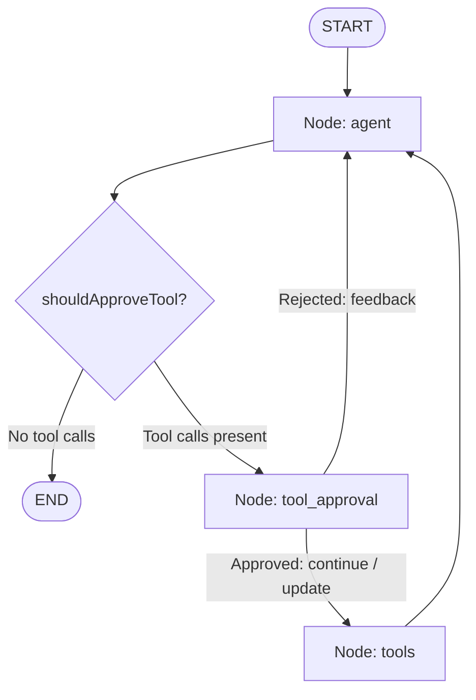

# 🧠 06-LANGCHAIN-LANGGRAPH-AND-AGENTS.md — Orchestration & Agent Architecture

---

## 📌 Document Metadata & Core Source Files

- **Primary Source File**: [src/lib/agent/builder.ts](file:///c:/Projects/AgentSphere/src/lib/agent/builder.ts)
- **Agent Factory & Cache**: [src/lib/agent/index.ts](file:///c:/Projects/AgentSphere/src/lib/agent/index.ts)
- **Model Initializer & Sanitizer**: [src/lib/agent/util.ts](file:///c:/Projects/AgentSphere/src/lib/agent/util.ts)
- **Memory Checkpointer**: [src/lib/agent/memory.ts](file:///c:/Projects/AgentSphere/src/lib/agent/memory.ts)
- **Streaming Orchestrator**: [src/services/agentService.ts](file:///c:/Projects/AgentSphere/src/services/agentService.ts)

---

## 1. Foundational Concepts from Zero

### 1.1 What is an LLM?

A **Large Language Model (LLM)** is a statistical neural network trained on massive corpora of text. At its core, an LLM performs one mathematical operation:
Given a sequence of preceding tokens (words or sub-words), it calculates a probability distribution over the entire vocabulary to predict the **next most likely token**.

- **Tokens**: The basic units of text processed by an LLM (roughly 4 characters or 0.75 words in English).
- **Context Window**: The maximum number of tokens an LLM can remember in a single interaction (e.g., 128k tokens for `gpt-4o`, 1M tokens for `gemini-2.5-flash`).
- **Temperature**: A hyperparameter controlling randomness in token selection.
  - `0.0`: Completely deterministic; always picks the token with the highest mathematical probability (ideal for coding, mathematics, SQL queries).
  - `1.0`: Highly creative; samples from lower-probability tokens (ideal for brainstorming, creative writing).
  - AgentSphere exposes this directly in [src/components/ModelConfiguration.tsx](file:///c:/Projects/AgentSphere/src/components/ModelConfiguration.tsx#L182-L200).

---

### 1.2 Message Roles in Modern LLMs

In classical text completion, you sent raw strings. In modern chat models, prompts are structured as conversations with 4 distinct roles:

1. **`SystemMessage`**: High-level instructions defining the AI's identity, rules, boundaries, and formatting constraints. In AgentSphere, this is constructed in [src/lib/agent/prompt.ts](file:///c:/Projects/AgentSphere/src/lib/agent/prompt.ts) or derived from the active persona in [src/contexts/UISettingsContext.tsx](file:///c:/Projects/AgentSphere/src/contexts/UISettingsContext.tsx).
2. **`HumanMessage`**: The prompt or query submitted by the end user.
3. **`AIMessage`**: The response generated by the model. May contain raw text, or structured **`tool_calls`** requesting external actions.
4. **`ToolMessage`**: The output returned from an executed tool, fed back to the model with a matching `tool_call_id`.

---

### 1.3 What is an "AI Agent" vs. a "Simple LLM Call"?

| Dimension             | Simple LLM Call (Chain)                                                                                 | AI Agent (LangGraph State Machine)                                                                  |
| --------------------- | ------------------------------------------------------------------------------------------------------- | --------------------------------------------------------------------------------------------------- |
| **Control Flow**      | Rigid, linear, predefined pipeline (Input $\rightarrow$ Prompt $\rightarrow$ LLM $\rightarrow$ Output). | Dynamic, cyclic state machine (The LLM decides what to do next based on tool outputs).              |
| **Tool Usage**        | None, or fixed single function call.                                                                    | Multi-step tool use: can call Tool A, read result, call Tool B, and synthesize answers.             |
| **Error Recovery**    | If output is invalid, the script fails.                                                                 | If a tool returns an error, the agent reads the error message and attempts an alternative approach. |
| **Human-in-the-Loop** | Cannot pause mid-execution without losing process memory.                                               | Suspends execution via interrupts, persists graph state, and resumes upon approval.                 |

---

### 1.4 LangChain vs. LangGraph: Why They Are Not Interchangeable

A common interview trap is confusing **LangChain** with **LangGraph**.

- **LangChain (`@langchain/core`)**:
  - A library of **abstractions and connectors**.
  - Provides model adapters (`ChatOpenAI`, `ChatGoogleGenerativeAI`), message classes (`HumanMessage`, `AIMessage`), and prompt templates.
  - Uses LCEL (LangChain Expression Language) for linear, directed acyclic pipelines (`prompt.pipe(model).pipe(parser)`).
  - **Limitation**: LCEL cannot easily model loops, cycles, or stateful human approvals.
- **LangGraph (`@langchain/langgraph`)**:
  - An **orchestration framework** for building stateful, cyclic graphs.
  - Treats an agent as a finite state machine composed of **Nodes** (computational steps) and **Edges** (conditional transitions).
  - Manages mutable **State**, handles **Checkpointers** for permanent persistence, and provides **`interrupt()`** for human review.
- **Summary**: LangChain provides the _components_ (models, tools, messages); LangGraph builds the _workflow engine_ that directs them.

---

## 2. Anatomy of the AgentSphere StateGraph

In [src/lib/agent/builder.ts](file:///c:/Projects/AgentSphere/src/lib/agent/builder.ts#L137-L151), the core graph is assembled:

```typescript
build() {
  const stateGraph = new StateGraph(MessagesAnnotation);
  stateGraph
    .addNode("agent", this.callModel.bind(this))
    .addNode("tools", this.toolNode)
    .addNode("tool_approval", this.approveToolCall.bind(this), {
      ends: ["tools", "agent"],
    })
    .addEdge(START, "agent")
    .addConditionalEdges("agent", this.shouldApproveTool.bind(this), ["tool_approval", END])
    .addEdge("tools", "agent");

  const compiledGraph = stateGraph.compile({ checkpointer: this.checkpointer });
  return compiledGraph;
}
```



---

## 3. Detailed Specification of Every Graph Node

### Node 1: `agent`

- **Location**: [src/lib/agent/builder.ts:L123-L135](file:///c:/Projects/AgentSphere/src/lib/agent/builder.ts#L123-L135)
- **Function**: `callModel(state: typeof MessagesAnnotation.State)`
- **Responsibility**: Binds tools to the chat model and invokes the model with full message history and the system prompt.
- **Inputs**: `state.messages` (array of `BaseMessage`).
- **State Read**: Reads all historical messages in the thread.
- **State Modified**: Appends the new `AIMessage` returned by the model to `messages`.
- **Functions Called**:
  - `this.model.bindTools(this.tools)`: Passes JSON schemas of all available MCP tools to the LLM.
  - `modelInvoker.invoke(messages)`: Dispatches the API request to the external provider.
- **Model Used**: Determined dynamically by [src/lib/agent/util.ts](file:///c:/Projects/AgentSphere/src/lib/agent/util.ts#L22-L62) based on user configuration (`groq`, `google`, `openai`, `anthropic`).
- **Tools Available**: All dynamic tools loaded from enabled `MCPServer` database records.
- **What Happens Next**: Execution flows to conditional edge `shouldApproveTool`.
- **Failure Behavior**: If the LLM throws (network error, invalid API key, context length exceeded), an exception bubbles up to the stream handler.

---

### Conditional Edge: `shouldApproveTool`

- **Location**: [src/lib/agent/builder.ts:L48-L59](file:///c:/Projects/AgentSphere/src/lib/agent/builder.ts#L48-L59)
- **Function**: `shouldApproveTool(state)`
- **Logic**:
  ```typescript
  const lastMessage = messages[messages.length - 1];
  if (
    "tool_calls" in lastMessage &&
    Array.isArray(lastMessage.tool_calls) &&
    lastMessage.tool_calls?.length
  ) {
    return "tool_approval";
  }
  return END;
  ```
- **Routing**:
  - If the model emitted one or more `tool_calls` $\rightarrow$ routes to `tool_approval`.
  - If the model emitted standard text $\rightarrow$ routes to `END` (terminating the turn).

---

### Node 2: `tool_approval` (Human-in-the-Loop)

- **Location**: [src/lib/agent/builder.ts:L61-L121](file:///c:/Projects/AgentSphere/src/lib/agent/builder.ts#L61-L121)
- **Function**: `approveToolCall(state: typeof MessagesAnnotation.State)`
- **Responsibility**: Evaluates whether tool execution requires user permission, interrupts execution if necessary, and routes resumption.
- **Code Breakdown**:

  ```typescript
  if (this.approveAllTools) {
    return new Command({ goto: "tools" });
  }
  // Extract the pending tool call
  const toolCall = lastMessage.tool_calls![lastMessage.tool_calls!.length - 1];

  // Suspend graph execution and yield interrupt to client
  const humanReview = interrupt<
    { question: string; toolCall: ToolCall },
    { action: string; data: any }
  >({
    question: "Is this correct?",
    toolCall: toolCall,
  });
  ```

- **How Resumption Works**:
  When resumed with `opts.allowTool`:
  1. `reviewAction === "continue"` (User clicked Allow):
     - Returns `new Command({ goto: "tools" })`.
  2. `reviewAction === "update"` (User modified tool parameters):
     - Updates `lastMessage.tool_calls` with edited arguments.
     - Returns `new Command({ goto: "tools", update: { messages: [updatedMessage] } })`.
  3. `reviewAction === "feedback"` (User clicked Deny / Rejection):
     - Creates a `ToolMessage` containing rejection feedback.
     - Returns `new Command({ goto: "agent", update: { messages: [toolMessage] } })`. The model reads the rejection and reformulates its response!

---

### Node 3: `tools`

- **Location**: [src/lib/agent/builder.ts:L41](file:///c:/Projects/AgentSphere/src/lib/agent/builder.ts#L41)
- **Implementation**: `new ToolNode(tools || [])` (from `@langchain/langgraph/prebuilt`).
- **Responsibility**: Executes the actual tool requested in `lastMessage.tool_calls`.
- **Inputs**: Tool call name and arguments.
- **Outputs**: Appends a `ToolMessage` containing the tool's return string to `state.messages`.
- **Next Step**: Unconditional edge: `stateGraph.addEdge("tools", "agent")`. Always routes back to `agent` so the LLM can interpret the tool output.

---

## 4. State Persistence & Checkpointing

### How State is Maintained Across Interrupts

When `interrupt()` is called:

1. LangGraph serializes the entire `state` (all messages, channels, and execution pointers).
2. It writes the state to PostgreSQL via `postgresCheckpointer` (`PostgresSaver`) using the provided `thread_id`:
   - `checkpoints` table: Contains the serialized graph state snapshot.
   - `checkpoint_writes` table: Contains pending writes for the turn.
3. The server terminates the HTTP stream. Node.js memory can be completely reclaimed!
4. Hours or days later, when the user clicks "Allow", the frontend hits `/api/agent/stream?allowTool=allow&threadId=...`.
5. LangGraph loads the snapshot from PostgreSQL using the `thread_id`, restores state to the exact millisecond before the interrupt, and continues execution.

---

## 5. End-to-End Task Execution Trace

Let's trace: _"Search for local weather in San Francisco"_:

| Step   | Component                     | Action                                                               | State Change                                                                                        |
| ------ | ----------------------------- | -------------------------------------------------------------------- | --------------------------------------------------------------------------------------------------- |
| **1**  | Client                        | User types query; sends SSE request to `/api/agent/stream`.          | UI optimistically shows user message.                                                               |
| **2**  | `agentService.ts`             | Calls `streamResponse()`; builds `HumanMessage`.                     | Passes `{ messages: [HumanMessage] }` to LangGraph.                                                 |
| **3**  | `START` $\rightarrow$ `agent` | `callModel()` binds MCP tools; calls Groq/Gemini with system prompt. | Model returns `AIMessage` with `tool_calls: [{ name: "weather__get_temp", args: { city: "SF" } }]`. |
| **4**  | `shouldApproveTool`           | Inspects `tool_calls`; detects 1 call.                               | Routes to `tool_approval`.                                                                          |
| **5**  | `tool_approval`               | Calls `interrupt({ question: "Is this correct?", toolCall })`.       | Graph suspends. State saved to Postgres. Tool call emitted to SSE.                                  |
| **6**  | Client                        | Renders `<ToolCallDisplay>` with "Allow" and "Deny".                 | User clicks "Allow".                                                                                |
| **7**  | Client $\rightarrow$ Server   | Client calls `/api/agent/stream?allowTool=allow`.                    | Server creates `new Command({ resume: { action: "continue" } })`.                                   |
| **8**  | `tool_approval`               | Resumes; returns `new Command({ goto: "tools" })`.                   | Routes to `tools`.                                                                                  |
| **9**  | `tools` (`ToolNode`)          | Executes `weather__get_temp({ city: "SF" })`.                        | Appends `ToolMessage({ content: "68°F, Sunny" })`.                                                  |
| **10** | `tools` $\rightarrow$ `agent` | Loops back to `agent` node! Model reads tool output.                 | Model generates `AIMessage("The weather in San Francisco is currently 68°F and sunny.")`.           |
| **11** | `shouldApproveTool`           | Inspects last message. No tool calls!                                | Routes to `END`.                                                                                    |
| **12** | Server $\rightarrow$ Client   | Server emits `event: done`.                                          | Client displays completed response bubble.                                                          |

Proceed to [07-LLM-PROVIDERS-AND-TOOL-CALLING.md](file:///c:/Projects/AgentSphere/docs/agentsphere-study-guide/07-LLM-PROVIDERS-AND-TOOL-CALLING.md) to explore multi-provider LLM integrations, model configurations, and tool schema sanitization.
