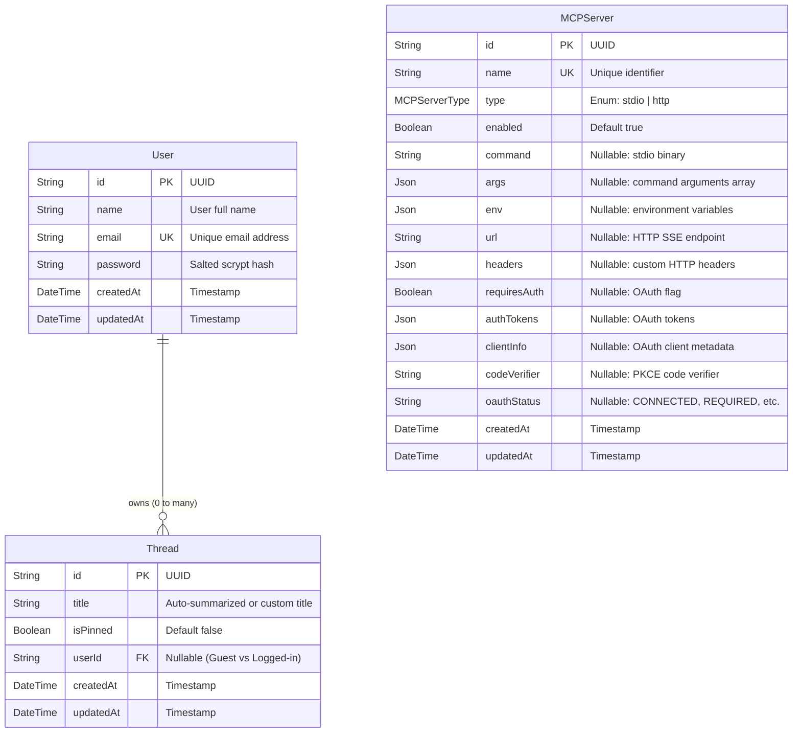
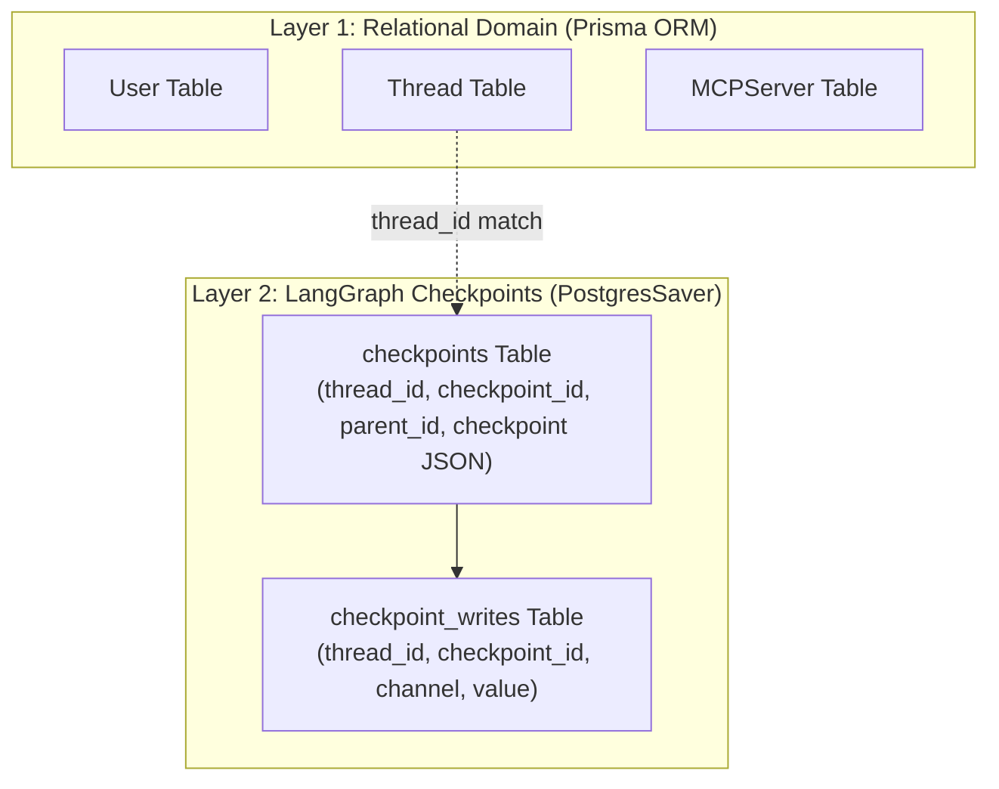

# 🗄️ 08-DATABASE-POSTGRESQL-PRISMA-AND-PERSISTENCE.md — Database Layer & Persistence

---

## 📌 Document Metadata & Schema Verification
- **Target Schema File**: [prisma/schema.prisma](file:///c:/Projects/AgentSphere/prisma/schema.prisma)
- **Checkpointer File**: [src/lib/agent/memory.ts](file:///c:/Projects/AgentSphere/src/lib/agent/memory.ts)
- **Database Engine**: PostgreSQL 17 (Dockerized on port `5434` / Cloud NeonDB)
- **ORM**: Prisma Client v6.16.2

---

## 1. Relational Database Concepts Explained from Zero

To understand AgentSphere's database layer, review these core relational principles:

- **Relational Database (RDBMS)**: A system that organizes data into strictly defined tables with rows and columns, linked by mathematical relationships (foreign keys).
- **Table**: A structured entity (e.g., `Thread`, `User`).
- **Primary Key (`@id`)**: A unique identifier guaranteed to identify exactly one row (e.g., UUID `3b9e8400-e29b-41d4-a716-446655440000`).
- **Foreign Key**: A column in one table referencing the Primary Key in another table to enforce referential integrity (e.g., `Thread.userId` references `User.id`).
- **Cascade Delete (`onDelete: Cascade`)**: If a parent row is deleted, the database automatically deletes all linked child rows (e.g., deleting a `User` automatically purges all their `Thread` records).
- **ORM (Object-Relational Mapping)**: An abstraction layer that translates between relational database tables and typed programming language objects.

---

## 2. Entity Relationship Diagram (ERD)



---

## 3. Field-by-Field Model Breakdown

### 3.1 The `User` Model
- **`id` (`String @id @default(uuid())`)**: Unique primary key.
- **`name` (`String`)**: User display name.
- **`email` (`String @unique`)**: Unique user login identifier. Enforced at the database level with a unique index.
- **`password` (`String`)**: Contains the password hash in the format `${salt}:${hash}` generated by `crypto.scryptSync`. Raw passwords are never stored.
- **`threads` (`Thread[]`)**: One-to-many virtual relation pointing to threads created by this user.

### 3.2 The `Thread` Model
- **`id` (`String @id @default(uuid())`)**: Unique conversation ID. Crucially, this same `id` is passed to LangGraph as the `thread_id` for checkpointing!
- **`title` (`String`)**: Conversation title. Defaults to `"New thread"`, auto-summarized to a 35-character snippet upon first user prompt.
- **`isPinned` (`Boolean @default(false)`)**: Pinned threads are sorted to the top of the sidebar.
- **`userId` (`String?`)**: Optional foreign key. Allows guest users to chat without an account (`userId = null`). When a guest signs up or logs in, existing threads can be linked to their account.
- **`user` (`User? @relation(fields: [userId], references: [id], onDelete: Cascade)`)**: If a user deletes their account, all their threads are deleted automatically.

### 3.3 The `MCPServer` Model
- **`type` (`enum MCPServerType { stdio, http }`)**:
  - `stdio`: Spawns a local binary process using `command`, `args`, and `env`.
  - `http`: Connects to a remote HTTP/SSE endpoint using `url`, `headers`, and optional OAuth.
- **`requiresAuth`, `authTokens`, `clientInfo`, `codeVerifier`, `oauthStatus`**: Fields dedicated to managing dynamic OAuth 2.0 PKCE authentication flows for secure remote MCP servers.

---

## 4. The Dual-Layer Persistence Architecture



### Why Doesn't Prisma Store Messages?
Notice that there is no `Message` model in `schema.prisma`.
- In standard chatbots, developers create a `Message` table with columns like `role` and `content`.
- In an **agentic system**, message states are far more complex: messages can be content blocks, image buffers, pending tool interrupts, function calls, or graph channel updates.
- Instead of flattening this into a relational table, AgentSphere delegates conversation history to **LangGraph's official `PostgresSaver` checkpointer** ([src/lib/agent/memory.ts](file:///c:/Projects/AgentSphere/src/lib/agent/memory.ts)).
- Prisma manages the high-level thread metadata; PostgreSQL stores the turn-by-turn binary execution states.

---

## 5. CRUD Query Traces from Code

### 5.1 Fetching User Threads with Guest Fallback
In [src/app/api/agent/threads/route.ts:L18-L40](file:///c:/Projects/AgentSphere/src/app/api/agent/threads/route.ts#L18-L40):
```typescript
const user = await getCurrentUser();

const whereCondition = user
  ? { OR: [{ userId: user.id }, { userId: null }] }
  : { userId: null };

const dbThreads = await prisma.thread.findMany({
  where: whereCondition,
  orderBy: [{ isPinned: "desc" }, { updatedAt: "desc" }],
  take: 50,
});
```
- **Explanation**: If logged in, users see both their registered threads and any unclaimed guest threads created before logging in. Pinned threads are prioritized first.

### 5.2 Auto-Summarizing Titles
In [src/lib/thread.ts:L37-L45](file:///c:/Projects/AgentSphere/src/lib/thread.ts#L37-L45):
```typescript
if (existing.title === "New thread" && titleSeed) {
  updateData.title = generateSmartTitle(titleSeed);
  await prisma.thread.update({
    where: { id: threadId },
    data: updateData,
  });
}
```

---

## 6. Database Safety & Migration Procedures

### Migration Commands Comparison
1. **`pnpm prisma:migrate` (`prisma migrate dev`)**:
   - Safe for development and production. Compares schema to database, generates SQL migration scripts, applies them, and tracks history in `_prisma_migrations`.
2. **`pnpm prisma:push` (`prisma db push --accept-data-loss`)**:
   - Forces database tables to match the schema immediately without migration files.
   - ⚠️ **DANGER WARNING**: Can irreversibly delete existing tables and column data if columns were renamed or dropped. Used in `render.yaml` for rapid prototype deployment, but must be avoided in production enterprise systems.

Proceed to [09-AUTHENTICATION-SESSIONS-AND-SECURITY.md](file:///c:/Projects/AgentSphere/docs/agentsphere-study-guide/09-AUTHENTICATION-SESSIONS-AND-SECURITY.md) to explore the authentication, password hashing, and security implementation.
