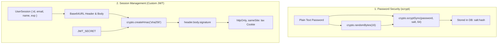

# 🔒 09-AUTHENTICATION-SESSIONS-AND-SECURITY.md — Authentication, Sessions & Threat Analysis

---

## 📌 Document Metadata & Core Source File

- **Primary Source File**: [src/lib/auth.ts](file:///c:/Projects/AgentSphere/src/lib/auth.ts)
- **API Endpoints**: [src/app/api/auth/](file:///c:/Projects/AgentSphere/src/app/api/auth)
- **Database Model**: `User` model in [prisma/schema.prisma](file:///c:/Projects/AgentSphere/prisma/schema.prisma)

---

## 1. Zero-Dependency Authentication Architecture

Most web applications rely on third-party libraries like `jsonwebtoken`, `bcrypt`, or `next-auth`.
**AgentSphere implements its entire cryptographic auth layer using Node.js's built-in `crypto` module**, eliminating external dependency vulnerabilities:



---

## 2. Password Hashing: Why `scrypt`?

In [src/lib/auth.ts:L13-L24](file:///c:/Projects/AgentSphere/src/lib/auth.ts#L13-L24):

```typescript
export function hashPassword(password: string): string {
  const salt = crypto.randomBytes(16).toString("hex");
  const hash = crypto.scryptSync(password, salt, 64).toString("hex");
  return `${salt}:${hash}`;
}

export function verifyPassword(password: string, storedHash: string): boolean {
  const [salt, hash] = storedHash.split(":");
  if (!salt || !hash) return false;
  const verifyHash = crypto.scryptSync(password, salt, 64).toString("hex");
  return crypto.timingSafeEqual(Buffer.from(hash, "hex"), Buffer.from(verifyHash, "hex"));
}
```

### Why Not MD5 or SHA-256?

- Fast hashing algorithms (MD5, SHA-1, SHA-256) are designed for speed. An attacker using modern GPUs can test billions of hashes per second.
- **`scrypt` is a memory-hard key derivation function**. It requires substantial RAM and computation cycles per iteration, making brute-force and rainbow table attacks virtually impossible.

### Timing Attack Defense: `crypto.timingSafeEqual`

In standard JavaScript:

```javascript
hash === verifyHash; // VULNERABLE!
```

Standard string comparison returns `false` as soon as the first mismatched character is detected. An attacker can measure nanosecond timing differences to guess hash characters one by one.
`crypto.timingSafeEqual` compares every byte in constant time regardless of where differences occur, completely neutralizing timing attacks.

---

## 3. JWT Signing & Verification Architecture

In [src/lib/auth.ts:L26-L69](file:///c:/Projects/AgentSphere/src/lib/auth.ts#L26-L69):

### 3.1 Token Structure

AgentSphere generates industry-standard **JSON Web Tokens (JWT)**:

1. **Header**: `{"alg": "HS256", "typ": "JWT"}` encoded as base64url.
2. **Payload**: `{ id, email, name, exp: Math.floor(Date.now() / 1000) + 7 * 24 * 3600 }` (7-day validity).
3. **Signature**: `HMAC-SHA256(header.payload, JWT_SECRET)` encoded as base64url.

### 3.2 Verification Routine

1. Splits token by `.`. If parts $\ne 3$, rejects immediately.
2. Re-computes expected HMAC signature using `JWT_SECRET`.
3. Verifies signatures via `crypto.timingSafeEqual`.
4. Inspects payload `exp` timestamp. If expired, rejects token.
5. Returns typed `UserSession` object.

---

## 4. Cookie Security Flags

In [src/app/api/auth/login/route.ts:L37-L44](file:///c:/Projects/AgentSphere/src/app/api/auth/login/route.ts#L37-L44):

```typescript
res.cookies.set(COOKIE_NAME, token, {
  httpOnly: true,
  secure: process.env.NODE_ENV === "production",
  sameSite: "lax",
  maxAge: 7 * 24 * 3600,
  path: "/",
});
```

- **`httpOnly: true`**: Inaccessible to JavaScript `document.cookie`. Protects session tokens from theft via Cross-Site Scripting (XSS).
- **`secure: true` (Production)**: Cookie only transmitted over encrypted HTTPS connections.
- **`sameSite: "lax"`**: Prevents cookie transmission on third-party cross-site requests, mitigating Cross-Site Request Forgery (CSRF).

---

## 5. Security & Threat Model Audit

| Threat Vector             | Severity | Status in AgentSphere   | Implementation & Mitigation                                                                                         |
| ------------------------- | -------- | ----------------------- | ------------------------------------------------------------------------------------------------------------------- |
| **SQL Injection**         | Critical | **Mitigated**           | Prisma uses parameterized SQL queries exclusively. User inputs never concatenate into raw SQL.                      |
| **XSS (Token Theft)**     | High     | **Mitigated**           | Session tokens stored in `httpOnly` cookies rather than `localStorage`.                                             |
| **Timing Attacks**        | Medium   | **Mitigated**           | `crypto.timingSafeEqual` used for password and token comparisons.                                                   |
| **CSRF**                  | Medium   | **Mitigated**           | `sameSite: "lax"` cookie policy prevents cross-site request forgery.                                                |
| **Prompt Injection**      | High     | **Partially Mitigated** | Human-in-the-Loop approval gate intercepts tool calls before execution.                                             |
| **Rate Limiting & Abuse** | High     | **Not Implemented** ⚠️  | No IP or user-level rate limiting exists on `/api/agent/stream` or `/api/auth/login`.                               |
| **Token Revocation**      | Medium   | **Not Implemented** ⚠️  | Tokens are stateless. Logging out clears the client cookie, but the token remains valid until expiration if stolen. |

Proceed to [10-ENVIRONMENT-SETUP-AND-DEPLOYMENT.md](file:///c:/Projects/AgentSphere/docs/agentsphere-study-guide/10-ENVIRONMENT-SETUP-AND-DEPLOYMENT.md) to inspect setup commands, Docker provisioning, and deployment configurations.
