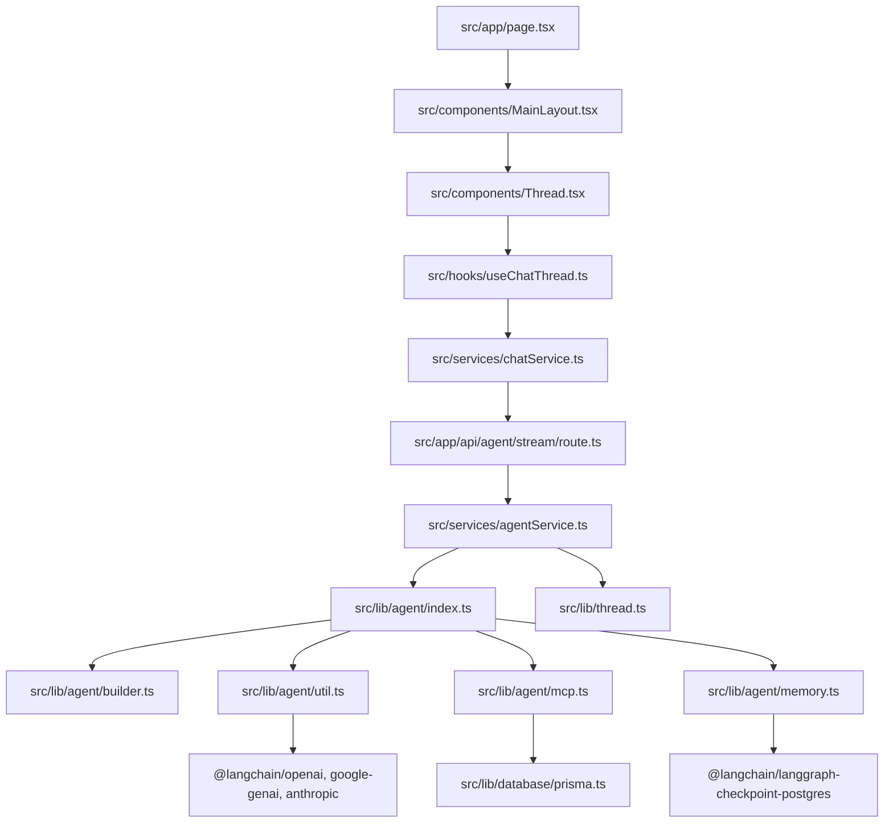

# 🗺️ 11-FILE-BY-FILE-CODE-TOUR.md — Exhaustive Source Code Inventory

---

## 📌 Document Metadata & Inspection Rule

This guide walks through every critical source file in AgentSphere, detailing:

1. **Purpose & Role in Architecture**
2. **Key Exports, Inputs & Outputs**
3. **Upstream Callers & Downstream Dependencies**
4. **Line-by-Line Code Breakdown for Critical Sections**
5. **Interview Talking Points**

---

## 1. Module Dependency Map



---

## 2. The Core Agent Layer

### 2.1 `src/lib/agent/builder.ts` (The Brain)

- **Path**: [src/lib/agent/builder.ts](file:///c:/Projects/AgentSphere/src/lib/agent/builder.ts) (153 lines)
- **Purpose**: Assembles the LangGraph `StateGraph(MessagesAnnotation)`.
- **Main Export**: `class AgentBuilder`
- **Dependencies**: `@langchain/langgraph`, `@langchain/langgraph/prebuilt`, `@langchain/core/messages`.
- **Called By**: [src/lib/agent/index.ts](file:///c:/Projects/AgentSphere/src/lib/agent/index.ts#L57).

#### Detailed Code Walkthrough:

```typescript
// Lines 48-59: Conditional Routing
private shouldApproveTool(state: typeof MessagesAnnotation.State) {
  const { messages } = state;
  const lastMessage = messages[messages.length - 1];
  if (
    "tool_calls" in lastMessage &&
    Array.isArray(lastMessage.tool_calls) &&
    lastMessage.tool_calls?.length
  ) {
    return "tool_approval"; // Divert to human review
  }
  return END; // Finish turn
}
```

_Why this exists_: Prevents unreviewed tool calls. If the LLM generates a tool call, execution transitions to the approval node; otherwise, the turn concludes.

```typescript
// Lines 61-86: Human-in-the-Loop Interrupt
private async approveToolCall(state: typeof MessagesAnnotation.State) {
  if (this.approveAllTools) {
    return new Command({ goto: "tools" });
  }
  const toolCall = lastMessage.tool_calls![lastMessage.tool_calls!.length - 1];
  const humanReview = interrupt<{ question: string; toolCall: ToolCall }, { action: string; data: any }>({
    question: "Is this correct?",
    toolCall: toolCall,
  });
  ...
```

_Why this exists_: `interrupt()` pauses LangGraph, serializes state to PostgreSQL, and waits for a user response. When resumed, `humanReview.action` directs execution to `tools` (approved) or `agent` (denied).

---

### 2.2 `src/lib/agent/index.ts` (Agent Factory & Cache)

- **Path**: [src/lib/agent/index.ts](file:///c:/Projects/AgentSphere/src/lib/agent/index.ts) (98 lines)
- **Purpose**: Creates and caches compiled LangGraph agent instances based on configuration options.
- **Main Exports**: `ensureAgent(cfg)`, `getAgent(cfg)`, `getDefaultAgent()`.
- **Key Implementation Decision**:
  - `agentCache`: Caches the compiled agent by a serialized JSON key (`{ model, provider, tools, approveAllTools, temperature, systemPrompt }`). If a user sends another message with identical settings, the pre-compiled graph is reused, avoiding redundant database lookups.
  - `setupOnce()`: Initializes the PostgreSQL checkpointer schema on first execution.

---

### 2.3 `src/lib/agent/util.ts` (Model Factory & Sanitizer)

- **Path**: [src/lib/agent/util.ts](file:///c:/Projects/AgentSphere/src/lib/agent/util.ts) (276 lines)
- **Purpose**: Initializes chat model instances and sanitizes tool schemas for Gemini.
- **Main Exports**: `createChatModel()`, `sanitizeTool()`, `getDefaultProvider()`, `getDefaultModel()`.
- **Critical Function `sanitizeSchema()`**:
  - Recursively removes 32 unsupported JSON Schema keywords (`$schema`, `examples`, `anyOf`, etc.) that cause Google Gemini to reject function calling schemas.
  - Normalizes array type definitions (`["string", "null"]` $\rightarrow$ `"string"`).

---

### 2.4 `src/lib/agent/mcp.ts` (MCP Tool Discovery)

- **Path**: [src/lib/agent/mcp.ts](file:///c:/Projects/AgentSphere/src/lib/agent/mcp.ts) (132 lines)
- **Purpose**: Queries PostgreSQL for enabled `MCPServer` entries and initializes `@langchain/mcp-adapters`.
- **Main Exports**: `getMCPServerConfigs()`, `createMCPClient()`, `getMCPTools()`.
- **Caching**: Tools are cached in-memory for 60 seconds (`MCP_CACHE_TTL_MS = 60_000`) to avoid repeatedly querying the database and spawning child processes on every streaming chunk.

---

### 2.5 `src/lib/agent/memory.ts` (LangGraph Checkpointer)

- **Path**: [src/lib/agent/memory.ts](file:///c:/Projects/AgentSphere/src/lib/agent/memory.ts) (49 lines)
- **Purpose**: Configures persistence for LangGraph using PostgreSQL.
- **Main Exports**: `postgresCheckpointer`, `createCheckpointer()`, `getHistory(threadId)`.
- **Fallback**: If `DATABASE_URL` is unavailable (e.g. during standalone test runs), gracefully falls back to `new MemorySaver()`.

---

## 3. Services Layer

### 3.1 `src/services/agentService.ts` (Backend Stream Coordinator)

- **Path**: [src/services/agentService.ts](file:///c:/Projects/AgentSphere/src/services/agentService.ts) (198 lines)
- **Purpose**: Bridges Next.js Route Handlers with the LangGraph execution engine.
- **Main Exports**: `streamResponse(params)`, `fetchThreadHistory(threadId)`.
- **Key Logic**:
  - Checks if `opts.allowTool` is present $\rightarrow$ initializes `new Command({ resume: { action: ... } })`.
  - Attaches Langfuse `CallbackHandler` if `LANGFUSE_ENABLED=true`.
  - Generator function `generator()` parses chunks from `agent.stream()` and yields typed `MessageResponse` objects.

### 3.2 `src/services/chatService.ts` (Frontend API Client)

- **Path**: [src/services/chatService.ts](file:///c:/Projects/AgentSphere/src/services/chatService.ts) (114 lines)
- **Purpose**: Client-side network client for threads, history, and EventSource streams.
- **Main Exports**: `createMessageStream(threadId, message, opts)`, `fetchMessageHistory(threadId)`, `fetchThreads()`, `createNewThread()`, `deleteThread(id)`, `updateThread(params)`.

---

## 4. Frontend Hooks & Contexts

### 4.1 `src/hooks/useChatThread.ts`

- **Path**: [src/hooks/useChatThread.ts](file:///c:/Projects/AgentSphere/src/hooks/useChatThread.ts) (226 lines)
- **Purpose**: Primary hook managing conversation state for a specific thread ID.
- **Key Implementation Details**:
  - `useQuery(["messages", threadId])`: Loads message history.
  - `handleStreamResponse()`: Opens `EventSource`. On message chunks, concatenates text by message ID and immutably updates the React Query cache.
  - `sendMessage()`: Applies optimistic update with synthetic human message before the network call starts.

### 4.2 `src/contexts/UISettingsContext.tsx`

- **Path**: [src/contexts/UISettingsContext.tsx](file:///c:/Projects/AgentSphere/src/contexts/UISettingsContext.tsx) (276 lines)
- **Purpose**: Global state management for provider, model, personas, temperature, system prompt, and theme.
- **Persistence**: Synchronizes settings with `localStorage.getItem("agent_model_settings")`.

---

## 5. Security & Authentication Layer

### 5.1 `src/lib/auth.ts`

- **Path**: [src/lib/auth.ts](file:///c:/Projects/AgentSphere/src/lib/auth.ts) (79 lines)
- **Purpose**: Zero-dependency cryptographic authentication.
- **Functions**:
  - `hashPassword(password)`: Generates a 16-byte random salt and derives hash using `crypto.scryptSync(password, salt, 64)`.
  - `verifyPassword(password, storedHash)`: Derives hash and validates using `crypto.timingSafeEqual`.
  - `signToken(payload)`: Signs base64url header and payload with HMAC-SHA256.
  - `verifyToken(token)`: Validates signature and expiration timestamp.
  - `getCurrentUser()`: Extracts token from Next.js server cookies (`cookies().get(COOKIE_NAME)`).

---

## 6. How to Explain Specific Files in an Interview

| If the Interviewer Asks About... | Point to This File                                                                           | Explain This Exact Mechanism                                                                                                  |
| -------------------------------- | -------------------------------------------------------------------------------------------- | ----------------------------------------------------------------------------------------------------------------------------- |
| **Human-in-the-Loop**            | [src/lib/agent/builder.ts](file:///c:/Projects/AgentSphere/src/lib/agent/builder.ts#L74)     | Show `interrupt()`. Explain how it pauses the StateGraph, serializes state in PostgreSQL, and resumes via `Command.resume()`. |
| **Model Compatibility**          | [src/lib/agent/util.ts](file:///c:/Projects/AgentSphere/src/lib/agent/util.ts#L76)           | Explain `sanitizeSchema()`. Show how Gemini crashes on 32 standard JSON Schema keywords and how AgentSphere cleans them.      |
| **Optimistic UI & Streaming**    | [src/hooks/useChatThread.ts](file:///c:/Projects/AgentSphere/src/hooks/useChatThread.ts#L75) | Explain chunk accumulation in TanStack Query by matching `data.id`.                                                           |
| **Session Security**             | [src/lib/auth.ts](file:///c:/Projects/AgentSphere/src/lib/auth.ts#L13)                       | Explain why `scrypt` is memory-hard and how `crypto.timingSafeEqual` prevents timing attacks.                                 |

Proceed to [12-END-TO-END-FEATURE-TRACES.md](file:///c:/Projects/AgentSphere/docs/agentsphere-study-guide/12-END-TO-END-FEATURE-TRACES.md) to trace the application's major features from user click to final response.
