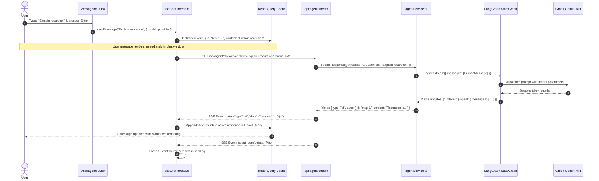
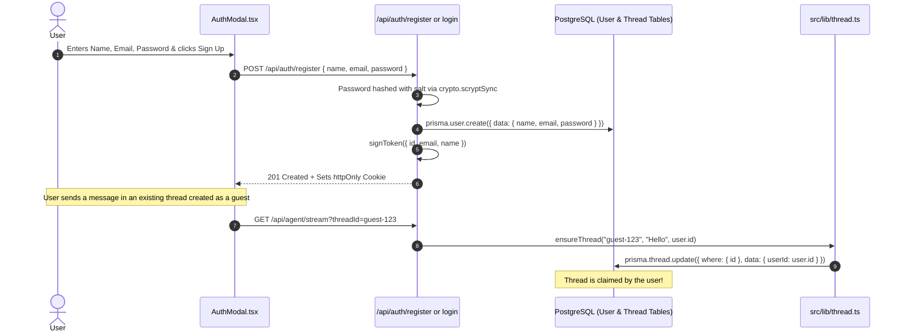

# 🔄 12-END-TO-END-FEATURE-TRACES.md — Complete Feature Execution Traces

---

## 📌 Document Metadata & Tracing Methodology

This document traces the 6 core features of AgentSphere from the initial user gesture on the screen, through frontend hooks, network transport, backend route handlers, database queries, and LLM calls, back to the final UI update.

---

## Feature 1: Sending a Message & Streaming an AI Response



### Trace Step-by-Step Breakdown:

1. **User Action**: Enters prompt and clicks Send.
2. **Frontend Handler**: `handleSubmit()` in [src/components/MessageInput.tsx](file:///c:/Projects/AgentSphere/src/components/MessageInput.tsx#L153).
3. **Optimistic Cache Update**: `sendMessage()` in [src/hooks/useChatThread.ts](file:///c:/Projects/AgentSphere/src/hooks/useChatThread.ts#L164) adds a `human` message into the TanStack Query cache under a temporary ID (`temp-${Date.now()}`).
4. **Network Request**: `createMessageStream()` opens an `EventSource` connection to `/api/agent/stream`.
5. **Backend Processing**:
   - [src/app/api/agent/stream/route.ts](file:///c:/Projects/AgentSphere/src/app/api/agent/stream/route.ts) reads query params and initializes a `ReadableStream`.
   - [src/services/agentService.ts](file:///c:/Projects/AgentSphere/src/services/agentService.ts#L25) calls `ensureThread()`, inserting a row in Prisma's `Thread` table if it doesn't already exist.
   - `ensureAgent()` compiles the LangGraph StateGraph with the requested provider and checkpointer.
6. **AI Invocation**: `agent.stream()` executes the `agent` node, calling the LLM API.
7. **Streaming Response**: Chunks are wrapped in SSE syntax and pushed down the HTTP connection.
8. **UI Update**: `useChatThread`'s `stream.onmessage` handler concatenates text by message ID, triggering reactive re-renders in `<AIMessage>`.

---

## Feature 2: Tool Execution with Human-in-the-Loop Approval

```mermaid
sequenceDiagram
    autonumber
    actor User as User
    participant UI as ToolCallDisplay.tsx
    participant Hook as useChatThread.ts
    participant Route as /api/agent/stream
    participant Svc as agentService.ts
    participant LG as LangGraph StateGraph
    participant Tool as ToolNode & MCP Server

    Note over LG: Model generated tool call: db__query_users
    LG->>LG: shouldApproveTool -> tool_approval node
    LG->>LG: Calls interrupt({ question: "Is this correct?", toolCall })
    LG-->>Route: Execution halts; yields pending tool call
    Route-->>Hook: SSE sends { type: "ai", data: { tool_calls: [...] } }
    Hook-->>UI: Renders Approval Card: "db__query_users" [Allow] [Deny]

    User->>UI: Clicks [Allow]
    UI->>Hook: approveToolExecution(id, "allow")
    Hook->>Route: GET /api/agent/stream?allowTool=allow&threadId=t1
    Route->>Svc: streamResponse({ opts: { allowTool: "allow" } })
    Svc->>LG: agent.stream(new Command({ resume: { action: "continue" } }))
    LG->>Tool: tool_approval unblocks -> routes to tools node
    Tool->>Tool: Executes MCP tool call
    Tool-->>LG: Appends ToolMessage({ content: "{ totalUsers: 45 }" })
    LG->>LG: tools node loops back to agent node
    Note over LG: LLM synthesizes tool result into plain English
    LG-->>Route: Streams final answer
    Route-->>Hook: SSE streams text chunks
    Hook-->>User: Displays completed response bubble
```

### Trace Step-by-Step Breakdown:

1. **Model Action**: The LLM determines it needs external data and generates a `tool_calls` payload.
2. **Graph Interruption**: In [src/lib/agent/builder.ts:L74](file:///c:/Projects/AgentSphere/src/lib/agent/builder.ts#L74), `approveToolCall()` invokes `interrupt()`. LangGraph saves the exact execution state into PostgreSQL's `checkpoints` table and yields the tool call.
3. **Frontend Rendering**: `<AIMessage>` renders `<ToolCallDisplay>`, presenting expandable JSON arguments and **[Allow]** and **[Deny]** buttons.
4. **Approval Action**: The user clicks **[Allow]**.
5. **Resume Signal**: `approveToolExecution()` hits `/api/agent/stream?allowTool=allow`.
6. **Graph Resumption**: In [src/services/agentService.ts:L29](file:///c:/Projects/AgentSphere/src/services/agentService.ts#L29), the server passes `new Command({ resume: { action: "continue" } })`.
7. **Tool Execution**: LangGraph unblocks, executes the tool via `ToolNode`, appends a `ToolMessage`, and routes back to `agent` so the model can format the result.

---

## Feature 3: File Upload & Multimodal Reasoning

```mermaid
sequenceDiagram
    autonumber
    actor User as User
    participant Input as MessageInput.tsx
    participant UpRoute as /api/agent/upload
    participant S3 as MinIO / AWS S3
    participant StreamRoute as /api/agent/stream
    participant Content as content.ts
    participant LLM as Multimodal Model

    User->>Input: Drags image "receipt.png" onto dropzone
    Input->>UpRoute: POST multipart/form-data { file }
    UpRoute->>UpRoute: validateFile(file) (Checks size <= 5MB, MIME == image/png)
    UpRoute->>S3: Uploads file buffer via PutObjectCommand
    S3-->>UpRoute: Successfully stored
    UpRoute-->>Input: Returns { url, key, name, type, size }
    Input-->>User: Displays attachment chip in input box

    User->>Input: Types "What is the total on this receipt?" & hits Send
    Input->>StreamRoute: GET /api/agent/stream?content=...&attachments=[{...}]
    StreamRoute->>Content: processAttachmentsForAI(attachments)
    Content->>S3: Downloads image buffer & base64 encodes
    Content-->>StreamRoute: Returns [{ type: "image_url", image_url: { url: "data:image/png;base64,..." } }]
    StreamRoute->>LLM: HumanMessage({ content: [{ type: "text" }, { type: "image_url" }] })
    LLM-->>User: Streams response: "The total on the receipt is $42.50."
```

### Trace Step-by-Step Breakdown:

1. **Drag-and-Drop Gesture**: Handled by `handleDrop()` in [src/components/Thread.tsx](file:///c:/Projects/AgentSphere/src/components/Thread.tsx#L54-L59), turning on the glassmorphic dropzone overlay.
2. **Validation**: [src/lib/storage/validation.ts](file:///c:/Projects/AgentSphere/src/lib/storage/validation.ts) checks file extensions, MIME types, and maximum sizes (Images: 5MB, PDFs: 10MB).
3. **Upload**: [src/lib/storage/upload.ts](file:///c:/Projects/AgentSphere/src/lib/storage/upload.ts) uploads the buffer to MinIO or AWS S3.
4. **Multimodal Content Preparation**: In [src/lib/storage/content.ts](file:///c:/Projects/AgentSphere/src/lib/storage/content.ts), attachments are processed into LangChain content blocks. For images, buffers are converted into base64 data URIs (`data:image/png;base64,...`).
5. **Inference**: The vision-capable LLM (e.g., `gemini-2.5-flash` or `gpt-4o`) inspects the visual tokens and answers the query.

---

## Feature 4: User Registration, Login & Guest Thread Claiming



### Trace Step-by-Step Breakdown:

1. **Registration**: Validates password length ($\ge 6$), hashes password using a 16-byte random salt and `crypto.scryptSync(password, salt, 64)`, and inserts a new `User` row.
2. **Session Generation**: Issues an HS256 JWT containing `{ id, email, name, exp }` signed with `JWT_SECRET`.
3. **Cookie Storage**: Injects `agentsphere_auth_token` as an `httpOnly`, `sameSite: "lax"` cookie.
4. **Guest Claiming**: When a user was previously chatting unauthenticated, `Thread.userId` was `null`. When `ensureThread()` runs with an authenticated session, [src/lib/thread.ts:L32-L35](file:///c:/Projects/AgentSphere/src/lib/thread.ts#L32-L35) verifies the user in the database and updates `Thread.userId = dbUser.id`.

---

## Feature 5: Exporting Conversation History to Markdown

1. **User Action**: Clicks the **Export** button in [src/components/Header.tsx](file:///c:/Projects/AgentSphere/src/components/Header.tsx#L30-L62).
2. **Network Call**: Hits `GET /api/agent/history/${currentThreadId}`.
3. **Database Retrieval**: [src/lib/agent/memory.ts:L36-L46](file:///c:/Projects/AgentSphere/src/lib/agent/memory.ts#L36-L46) queries `postgresCheckpointer.get({ configurable: { thread_id } })`.
4. **Formatting**: Iterates through messages and structures a Markdown document:

   ```markdown
   # AgentSphere Conversation

   _Thread ID: 3b9e84..._
   _Exported: 10/13/2026, 10:30 PM_

   ### 👤 User

   What is an algorithm?

   ### 🤖 AgentSphere AI

   An algorithm is a step-by-step procedure...
   ```

5. **Download Trigger**: Instantiates a browser `Blob([mdContent], { type: "text/markdown" })`, generates an object URL (`URL.createObjectURL(blob)`), and triggers an automatic browser download.

---

## Feature 6: Voice Dictation & Read-Aloud Speech

1. **Speech-to-Text (Microphone Dictation)**:
   - User clicks mic icon in `MessageInput.tsx`.
   - Browser initializes `SpeechRecognition()`.
   - As words are spoken, `recognition.onresult` appends the transcribed text directly into the `message` state.
2. **Text-to-Speech (Read Aloud)**:
   - User clicks "Listen" in `AIMessage.tsx`.
   - Component cancels any existing speech (`window.speechSynthesis.cancel()`).
   - Instantiates `new SpeechSynthesisUtterance(messageContent)` and calls `window.speechSynthesis.speak(utterance)`.
   - An active pulse animation displays until `utterance.onend` fires.

Proceed to [13-ERROR-HANDLING-DEBUGGING-AND-TESTING.md](file:///c:/Projects/AgentSphere/docs/agentsphere-study-guide/13-ERROR-HANDLING-DEBUGGING-AND-TESTING.md) to learn how to diagnose failures, debug streams, and audit testing gaps.
