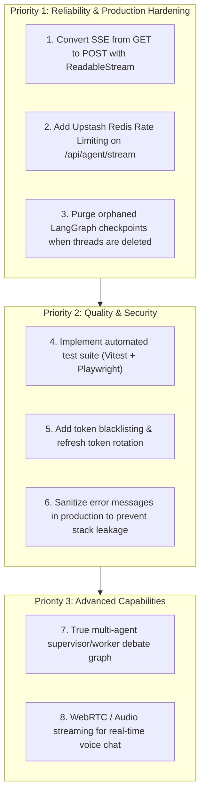

# ⚖️ 14-DESIGN-DECISIONS-TRADEOFFS-AND-IMPROVEMENTS.md — Design Decisions & Engineering Trade-Offs

---

## 📌 Document Metadata & Engineering Rationale

This document analyzes the technical trade-offs made in AgentSphere's implementation, evaluates alternative architectural paths, and outlines a prioritized roadmap for production improvements.

---

## 1. Key Architectural Decisions & Trade-Offs

### Decision 1: LangGraph StateGraph vs. Linear Chains (LCEL)

- **Current Implementation**: Implements a cyclic StateGraph with `agent`, `tool_approval`, and `tools` nodes in [src/lib/agent/builder.ts](file:///c:/Projects/AgentSphere/src/lib/agent/builder.ts).
- **The Alternative**: Simple linear LangChain Expression Language (LCEL) chain: `prompt.pipe(model).pipe(tools)`.
- **Advantages of Chosen Path**:
  - **Cycles**: Allows the model to inspect tool outputs and loop back to call additional tools if needed.
  - **Stateful Human Approval**: Provides native `interrupt()` and `Command.resume()`, allowing execution to freeze and persist to disk while awaiting user approval.
- **Trade-Off / Disadvantages**: Higher initial cognitive overhead and complex state annotation management compared to a simple linear function.

---

### Decision 2: Server-Sent Events (SSE) vs. WebSockets

- **Current Implementation**: Uses HTTP GET streaming with `text/event-stream` headers in [src/app/api/agent/stream/route.ts](file:///c:/Projects/AgentSphere/src/app/api/agent/stream/route.ts).
- **The Alternative**: Bidirectional WebSockets (`ws://` / `wss://`).
- **Advantages of Chosen Path**:
  - **Simplicity**: AI text generation is inherently unidirectional (server streams tokens to client). SSE runs over standard HTTP/1.1 and HTTP/2, requiring no stateful connection handshakes.
  - **Firewall & Proxy Friendly**: Works seamlessly through corporate proxies, CDNs, and serverless edge runtimes where persistent WebSocket connections are frequently terminated.
- **Trade-Off / Disadvantages**:
  - SSE is unidirectional. Resuming tool execution or sending inputs requires opening a separate request.
  - Browser `EventSource` natively supports only `GET` requests, forcing input parameters into URL query strings.

---

### Decision 3: Dual-Layer Persistence (Prisma + PostgresSaver)

- **Current Implementation**:
  - Prisma manages relational metadata (`User`, `Thread`, `MCPServer`).
  - LangGraph's `PostgresSaver` manages turn-by-turn conversation messages and graph states in dedicated checkpointer tables.
- **The Alternative**: A single relational `Message` table in Prisma storing `role` and `content`.
- **Advantages of Chosen Path**:
  - LangGraph's checkpoint format handles complex state: function call buffers, interrupt suspension points, and channel writes without requiring complex relational schema migrations every time agent features expand.
- **Trade-Off / Disadvantages**:
  - Deleting a thread in Prisma does not automatically delete the corresponding checkpoint rows in PostgreSQL, leaving orphaned checkpoint records.

---

### Decision 4: Custom Zero-Dependency Auth vs. Auth.js / NextAuth

- **Current Implementation**: Built-in Node.js `crypto` (`scryptSync`, `timingSafeEqual`, `createHmac`) in [src/lib/auth.ts](file:///c:/Projects/AgentSphere/src/lib/auth.ts).
- **The Alternative**: Third-party authentication frameworks like NextAuth.js, Clerk, or Supabase Auth.
- **Advantages of Chosen Path**:
  - **Zero External Dependencies**: Eliminates security supply-chain risks and frequent breaking changes common to auth libraries.
  - **Full Control**: Complete visibility over salt rounds, cookie flags, and token structures.
- **Trade-Off / Disadvantages**:
  - Lacks built-in OAuth social login (Google/GitHub sign-in), email verification, and automatic refresh token rotation.

---

### Decision 5: MinIO S3 Object Storage vs. Database BLOBs

- **Current Implementation**: Dockerized MinIO object storage with `@aws-sdk/client-s3` in [src/lib/storage/](file:///c:/Projects/AgentSphere/src/lib/storage).
- **The Alternative**: Storing base64 strings or binary blobs directly in PostgreSQL tables (`bytea` column).
- **Advantages of Chosen Path**:
  - **Performance**: Prevents database bloat and preserves query performance.
  - **Portability**: Switching from local development to production AWS S3, Cloudflare R2, or Google Cloud Storage requires updating only `.env` variables without changing a single line of application code.
- **Trade-Off / Disadvantages**: Requires running an additional Docker container (`minio`) during local development.

---

## 2. Prioritized Engineering Roadmap

### High Priority Improvements

1. **Convert SSE from GET to POST**:
   - _Problem_: Passing prompt content, attachments, and tool configs in query parameters can exceed the maximum URL length (~8KB) for long documents.
   - _Fix_: Use `fetch()` with `POST` and consume the `response.body` stream using a `ReadableStreamDefaultReader` on the client.
2. **Implement Rate Limiting**:
   - _Problem_: Anyone can spam `/api/agent/stream` and exhaust LLM API credits.
   - _Fix_: Implement token-bucket rate limiting via `@upstash/ratelimit` keyed by user ID or client IP.
3. **Clean Up Orphaned Checkpoints**:
   - _Problem_: Deleting a thread in Prisma leaves checkpoint rows in PostgreSQL indefinitely.
   - _Fix_: Add an explicit SQL trigger or Prisma hook in `DELETE /api/agent/threads` to delete rows from `checkpoints` where `thread_id = id`.

Proceed to [15-INTERVIEW-QUESTIONS-AND-ANSWERS.md](file:///c:/Projects/AgentSphere/docs/agentsphere-study-guide/15-INTERVIEW-QUESTIONS-AND-ANSWERS.md) for 100+ comprehensive interview questions and model answers.
